[](CITATION.cff)
<div align="center">

# Reproduction and Methodological Audit of QuCNet for Thyroid Nodule Classification

> **Scientific and data-release scope:** Evaluations described as *case-separated* ensure no repeated **recorded case ID** across their respective folds/partitions; the archive does **not** establish distinct patient identities. Earlier phase titles using “leakage-free” refer to case-ID grouping only and must not be read as proof of patient-level independence. The source data remain subject to the unresolved redistribution assessment linked below. The [research extension branch](https://github.com/karthikaxiom/QCNN_Thyroid_Paper_Reproduction/tree/research/bn-recalibration-audit) contains the current audit; the default `main` branch preserves earlier historical work.


### A Systematic Reproduction Study of Quantum-Inspired Deep Learning for Thyroid Ultrasound Classification Using the Public DDTI Dataset
<p align="center">
  
</p>
---


</div>

---

# Research Summary.

Artificial Intelligence has demonstrated remarkable success in medical image classification. Recently, Quantum Machine Learning (QML) has emerged as a promising research direction by combining concepts from quantum computing with deep learning architectures. One such work is **QuCNet**, a quantum-inspired convolutional framework proposed by Swathi, Altalbe and Kumar for thyroid nodule classification using ultrasound images [[1]](#references).

The reference study reported high classification performance for both tumour classification and multi-class TI-RADS prediction [[1]](#references) using quantum-inspired feature extraction on the Digital Database of Thyroid Ultrasound Images (DDTI). However, reproducing published research is often challenging because many implementation details, preprocessing decisions, dataset versions and experimental settings are not fully disclosed.

This repository presents an **independent reconstruction and methodological audit** of a QuCNet-style pipeline using the publicly available DDTI dataset.

Unlike a conventional implementation project, the primary objective of this work was **not to maximize classification accuracy**, but to answer a more fundamental scientific question:

> **Can the performance reported in the original QuCNet paper be independently reproduced using the publicly recoverable dataset and the implementation details described in the publication?**

To answer this question, the complete pipeline was reconstructed from scratch, including dataset verification, XML parsing, metadata extraction, preprocessing, quantum-inspired feature generation, classical and quantum baselines, annotation auditing, recorded-case-ID leakage analysis (without independently verifying patient identity), lesion-level ROI extraction, and a final leakage-free evaluation protocol.

The study reconstructed and audited the available experimental workflow and identified several important reproducibility challenges, including missing pathology labels, incomplete methodological specifications, annotation-level ambiguities, and patient-level data leakage risks.

Although the complete implementation pipeline was successfully executed, the reported performance of the original publication could **not** be independently reproduced using the publicly available resources.

These experiments do not reproduce the authors' exact test sets or label provenance; comparisons with the published accuracy figures are therefore methodological rather than like-for-like performance tests.

Rather than treating this as a failure, the project preserves these findings as a transparent and scientifically valuable reproducibility study.

---

# Why This Research Matters

Reproducibility is one of the foundations of scientific research.

A published model can only be considered reliable when independent researchers are able to reconstruct the methodology, obtain comparable experimental conditions, and verify the reported findings.

Medical AI research becomes particularly important because model performance may directly influence future clinical decision-support systems. Therefore, identifying missing implementation details, hidden assumptions, undocumented preprocessing steps, or dataset inconsistencies contributes to improving transparency and research quality.

This repository aims to provide a carefully documented reference implementation that future researchers can build upon while understanding the practical challenges involved in reproducing quantum-inspired medical image classification systems.

---

# Reference Study

This repository independently reproduces and audits the methodology presented in the following research article:

> **Gunti Swathi, Ali Altalbe and R. Prasanna Kumar**,  
> “QuCNet: Quantum-Inspired Convolutional Neural Networks for Optimized Thyroid Nodule Classification,”  
> *IEEE Access*, vol. 12, pp. 27829–27842, 2024.  
> **DOI:** [10.1109/ACCESS.2024.3367806](https://doi.org/10.1109/ACCESS.2024.3367806)

### Publication Details

| Field | Information |
|---|---|
| Title | QuCNet: Quantum-Inspired Convolutional Neural Networks for Optimized Thyroid Nodule Classification |
| Authors | Gunti Swathi, Ali Altalbe and R. Prasanna Kumar |
| Journal | IEEE Access |
| Volume | 12 |
| Pages | 27829–27842 |
| Publication Year | 2024 |
| DOI | [10.1109/ACCESS.2024.3367806](https://doi.org/10.1109/ACCESS.2024.3367806) |
| Publisher | Institute of Electrical and Electronics Engineers |
| Research Domain | Quantum-Inspired Learning and Thyroid Ultrasound Classification |

> [!IMPORTANT]
> This repository is an independent academic reproduction and methodological audit. It is not the official source-code implementation of the original authors and is not affiliated with IEEE or the authors of the reference study.
---

# Research Objectives

The objectives of this work were:

- Reconstruct the complete QuCNet pipeline using only publicly available resources.
- Study the DDTI dataset in detail by analysing XML annotations, metadata and image relationships.
- Develop a reproducible preprocessing pipeline for thyroid ultrasound images.
- Reconstruct the quantum-inspired feature generation procedure described in the paper.
- Compare quantum-inspired features against conventional grayscale image representations.
- Evaluate both binary and multi-class TI-RADS classification tasks.
- Investigate the effect of annotation quality, dataset structure and patient-level data leakage.
- Build a case-ID-disjoint lesion-level evaluation protocol using expert-marked ROI annotations.
- Document every phase of the reproduction process in chronological order.
- Preserve both successful implementations and negative experimental findings for future reproducibility research.

---

# Research Contributions

This repository provides:

- A complete phase-wise reconstruction of the QuCNet workflow.
- Automated XML parsing and metadata extraction for the DDTI dataset.
- Dataset verification and consistency auditing.
- Quantum-inspired feature generation pipeline.
- Classical CNN and Quantum-inspired CNN implementations.
- Controlled experimental comparisons.
- Annotation-level and recorded-case-ID auditing; patient linkage remains unverified.
- Case-ID-disjoint train-validation-test splitting, with patient identity uniqueness unverified.
- Lesion ROI dataset generation using expert annotations.
- ROI-level and Case-level performance evaluation.
- Complete research log documenting every development stage.
- Reproducible implementation scripts, reports and evaluation outputs.

---

# Current Project Status

| Component | Status |
|------------|--------|
| Dataset Verification | ✅ Completed |
| XML Metadata Parsing | ✅ Completed |
| Image Preprocessing | ✅ Completed |
| Binary Classification Reproduction | ✅ Completed |
| Quantum Feature Generation | ✅ Completed |
| Classical Baseline | ✅ Completed |
| Multi-Class TI-RADS Evaluation | ✅ Completed |
| Annotation Audit | ✅ Completed |
| Case-Level Leakage Audit | ✅ Completed |
| Frozen Dataset Split | ✅ Completed |
| ROI Dataset Generation | ✅ Completed |
| Final Case-Separated Evaluation | ✅ Completed |
| Research Documentation | ✅ Completed |

---

> **Project Outcome**
>
> A QuCNet-style workflow was reconstructed, implemented, and evaluated under documented experimental choices.
> However, the high classification performance reported in the original publication could not be independently reproduced using the publicly available DDTI dataset and the methodological details disclosed in the paper.
>
> The repository therefore serves as a **complete reproducibility study**, documenting both the implementation process and the scientific challenges encountered during independent verification.

---

<!-- VERIFIED_ARCHITECTURE_START -->

# Reproduced Architecture and Research Flow

## End-to-End Research Workflow

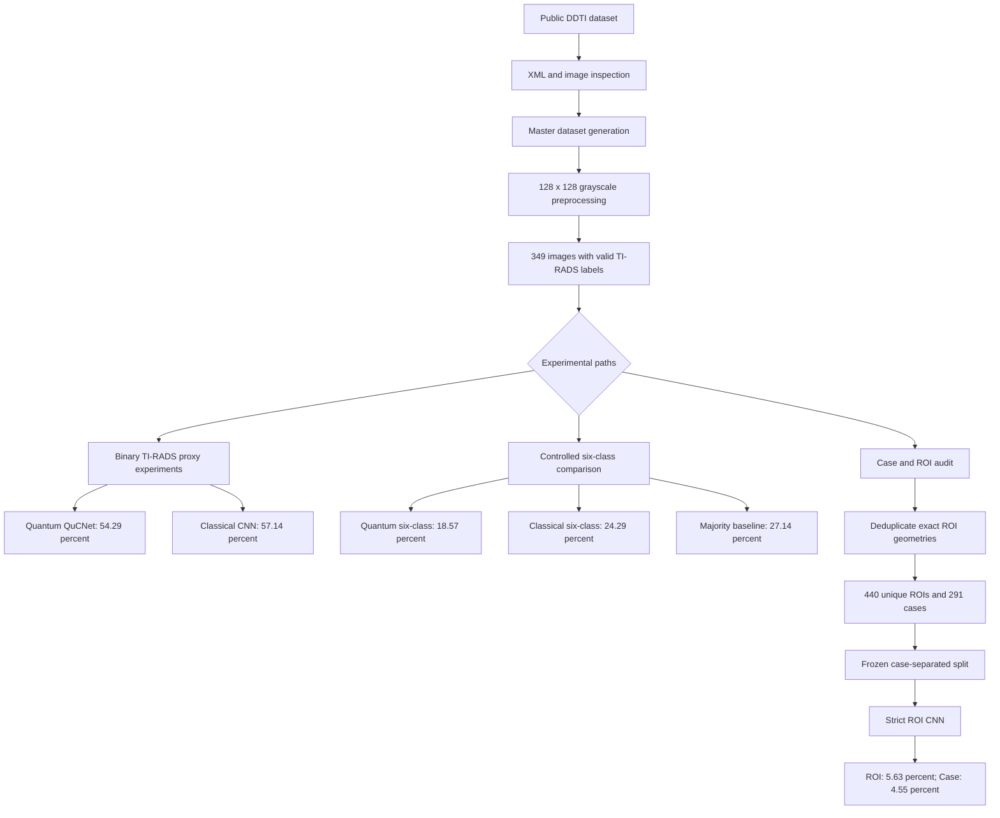

## Reconstructed QuCNet Architecture

```mermaid
flowchart LR
    A[128 x 128 grayscale image] --> B[Non-overlapping 2 x 2 patches]
    B --> C[Four-qubit PennyLane circuit]
    C --> D[RX data encoding]
    D --> E[Fixed random RY rotations]
    E --> F[CNOT ring: 0-1-2-3-0]
    F --> G[Four Pauli-Z measurements]
    G --> H[64 x 64 x 4 quantum feature tensor]
    H --> I[Classical neural classifier]
    I --> J[Binary proxy or six-class TI-RADS prediction]
```

The quantum circuit is used as a feature-transformation stage. Final classification is performed by a classical neural network, making the reproduced model a hybrid quantum-classical pipeline.

## Quantum Transformation Evidence

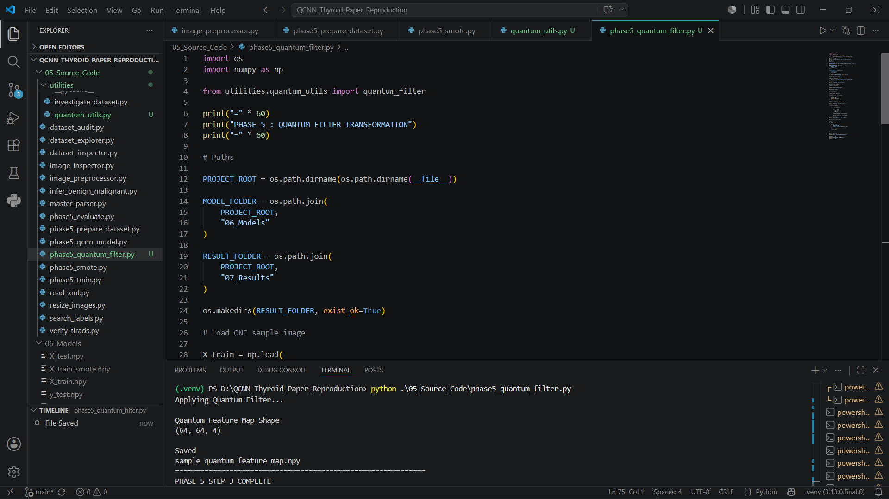

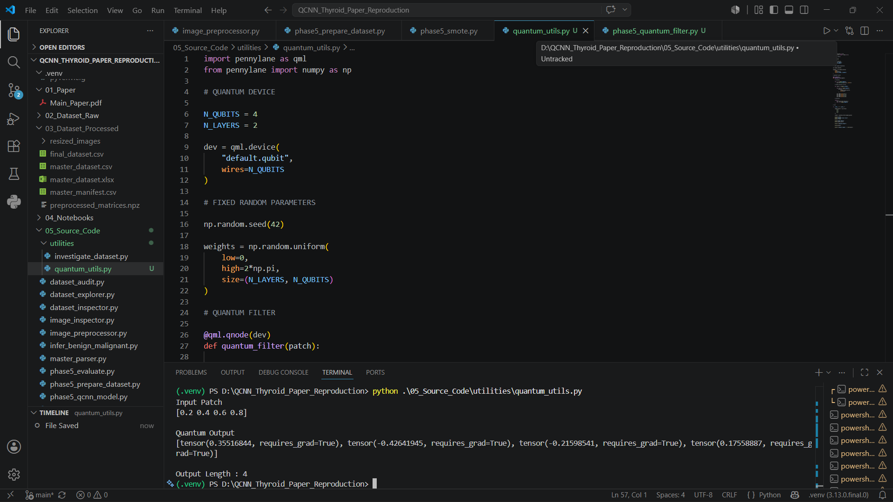

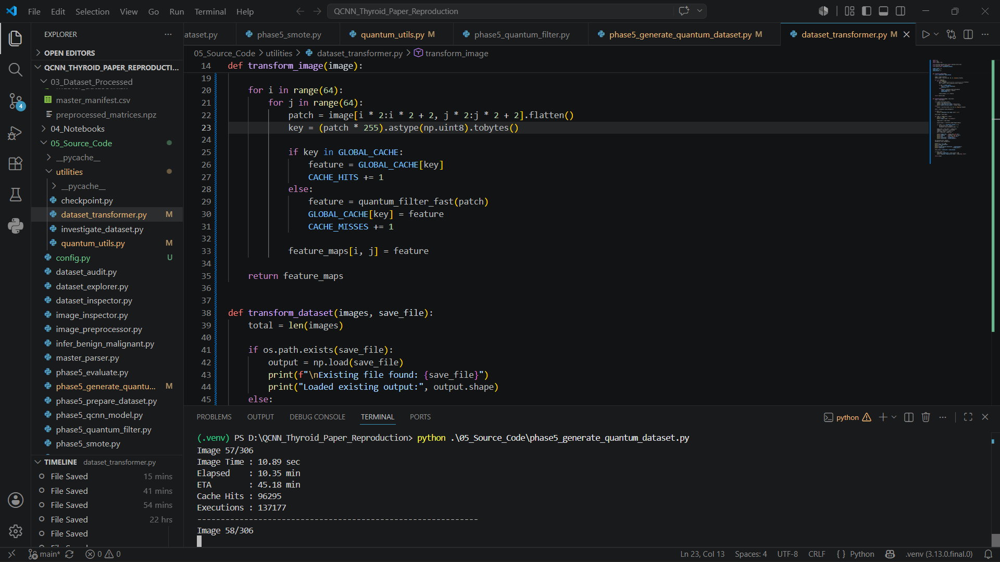

<!-- VERIFIED_ARCHITECTURE_END -->

<!-- VERIFIED_RESULTS_DASHBOARD_START -->

# Verified Research Results Dashboard

> [!IMPORTANT]
> This repository does not have one universal project accuracy. Each value
> below belongs to a different task, representation, or evaluation protocol.

## Complete Experimental Results

| Experiment | Task and Input | Evaluation Context | Accuracy |
|---|---|---|---:|
| Binary Quantum-Feature QuCNet | TI-RADS-derived binary proxy; `64 x 64 x 4` quantum features | Validation-selected 70-image holdout | **54.29%** |
| Binary Classical CNN | Same binary proxy; grayscale images | Historical matched image-level setting | **57.14%** |
| Six-Class Quantum-Feature QuCNet | Six TI-RADS classes; quantum-transformed features | Controlled image-level comparison | **18.57%** |
| Six-Class Classical CNN | Six TI-RADS classes; grayscale images | Matched controlled comparison | **24.29%** |
| Majority-Class Baseline | Six TI-RADS classes | Same controlled task | **27.14%** |
| Strict ROI CNN | Six TI-RADS classes; deduplicated lesion ROIs | Fixed historical case-separated test partition | **5.63%** |
| Strict Case Aggregation | Mean aggregation of strict ROI probabilities | Fixed historical case-separated test partition | **4.55%** |

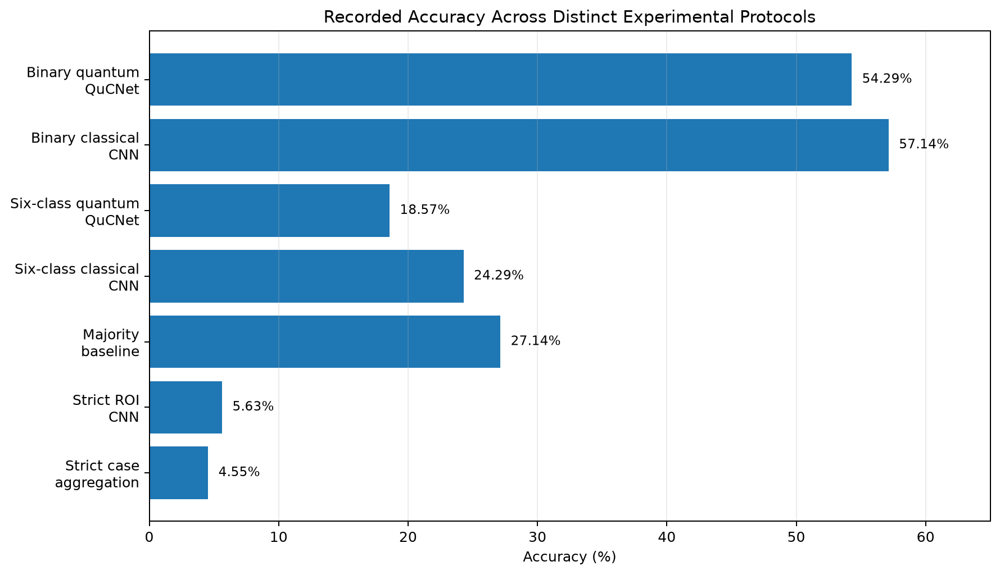

### Interpretation

- **54.29%** is the binary hybrid quantum-classical QuCNet result.
- **57.14%** is the corresponding binary classical CNN result.
- The binary labels are TI-RADS-derived suspicion proxies, not pathology-confirmed diagnoses.
- The six-class quantum model did not outperform the matched classical model.
- Phase 14 is a separate strict classical ROI baseline.
- The Phase 14 model predicted TI-RADS 3 for all 71 test ROIs and all 44 test cases.
- Therefore, 5.63% ROI and 4.55% case are not the overall project accuracy.
- The [training-only extension study](#extension-study-reproducibility-and-model-sensitivity) adds controlled preprocessing, data-integrity and fixed quantum/classical feature-map checks.

---

## Verified PennyLane Quantum Implementation

| Component | Verified Configuration |
|---|---|
| Framework | PennyLane 0.45.1 |
| Device | `default.qubit` |
| Input patch | Non-overlapping `2 x 2` grayscale pixels |
| Qubits | 4 |
| Layers | 2 |
| Encoding | `RX` |
| Fixed random rotations | `RY` |
| Entanglement | CNOT ring `0 -> 1 -> 2 -> 3 -> 0` |
| Measurements | Four Pauli-Z expectation values |
| Random seed | 42 |
| Output | `64 x 64 x 4` quantum feature tensor |
| Hardware | Classical CPU simulation |

The correct description is a **hybrid quantum-classical QuCNet-style
pipeline**: simulated quantum circuits generate features and a classical
neural network performs classification.

<table>
<tr>
<td align="center"><b>Quantum Filter Application</b></td>
<td align="center"><b>Four-Channel Quantum Features</b></td>
</tr>
<tr>
<td></td>
<td></td>
</tr>
</table>

---

# Visual Experimental Evidence

## Binary Proxy QuCNet

| Metric | Result |
|---|---:|
| Accuracy | **54.29%** |
| Precision | 56.14% |
| Recall | 82.05% |
| F1 Score | 66.67% |

<table>
<tr>
<td align="center"><b>Confusion Matrix</b></td>
<td align="center"><b>Precision-Recall Curve</b></td>
</tr>
<tr>
<td>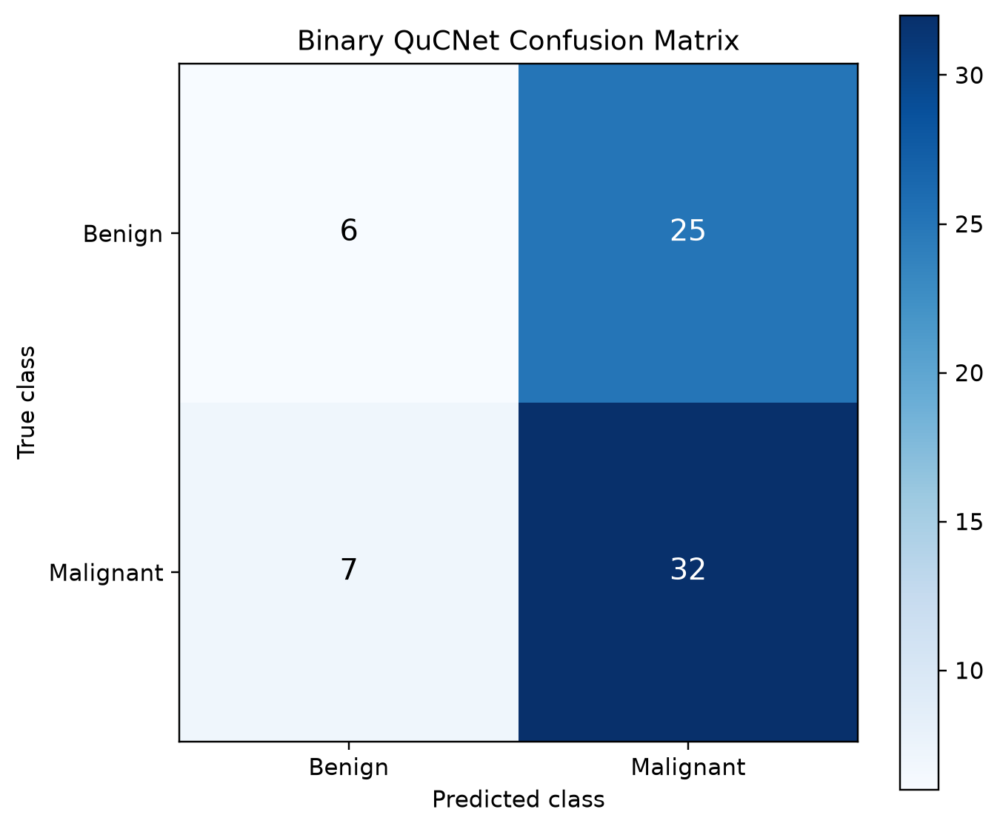</td>
<td>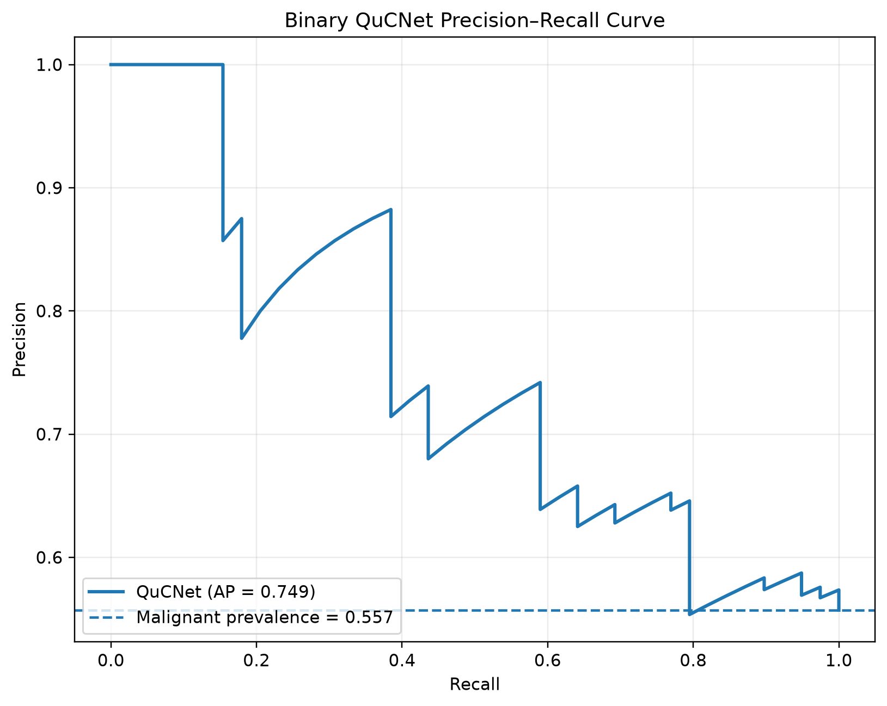</td>
</tr>
</table>

## Controlled Six-Class Comparison

| Model | Accuracy | Balanced Accuracy | Macro F1 | Weighted F1 |
|---|---:|---:|---:|---:|
| Quantum-Feature QuCNet | 18.57% | 15.16% | 6.72% | 8.74% |
| Classical Grayscale CNN | 24.29% | 28.09% | 23.18% | 22.76% |
| Majority-Class Baseline | 27.14% | - | - | - |

<table>
<tr>
<td align="center"><b>Quantum Confusion Matrix</b></td>
<td align="center"><b>Quantum Training Accuracy</b></td>
</tr>
<tr>
<td>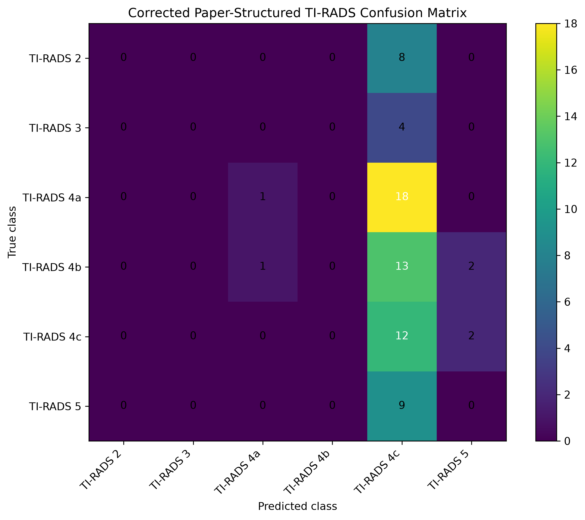</td>
<td>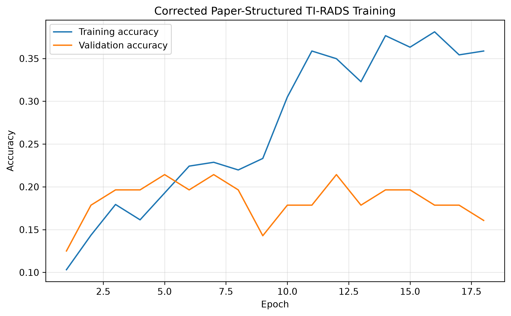</td>
</tr>
<tr>
<td align="center"><b>Classical Confusion Matrix</b></td>
<td align="center"><b>Classical Training Accuracy</b></td>
</tr>
<tr>
<td>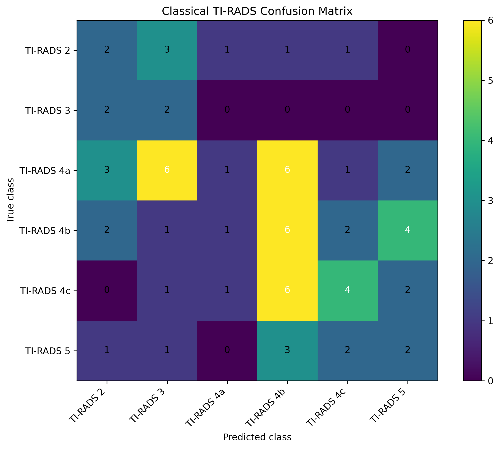</td>
<td>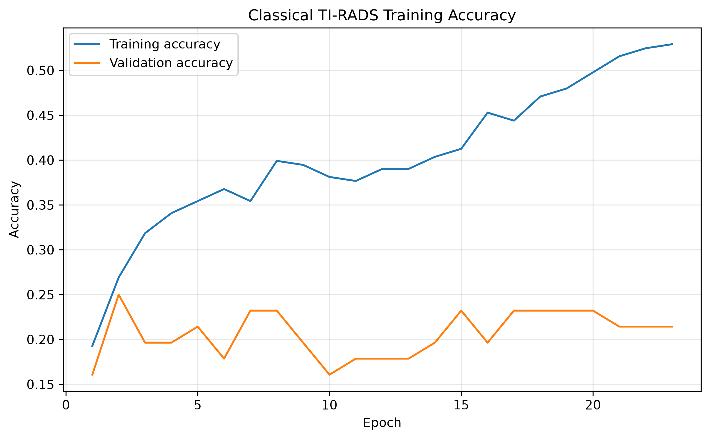</td>
</tr>
</table>

## Audited Dataset and ROI Evidence

| Audit Item | Verified Result |
|---|---:|
| Valid cases | **291** |
| Unique ROI geometries | **440** |
| Redundant ROI copies removed | **9** |
| Exact duplicate groups | **6** |
| Train / validation / test cases | **203 / 44 / 44** |
| Train / validation / test ROIs | **311 / 58 / 71** |
| Case overlap | **0** |
| ROI overlap | **0** |

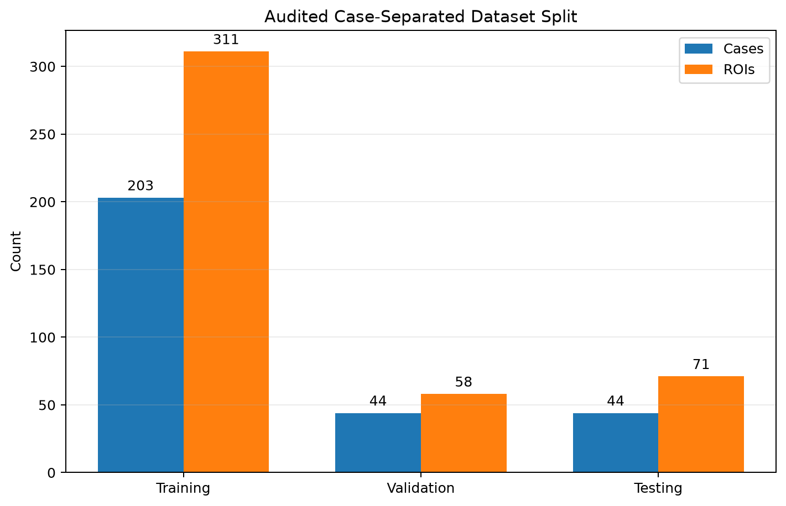

<table>
<tr>
<td align="center"><b>Annotation Audit Preview</b></td>
<td align="center"><b>Strict Test ROI Preview</b></td>
</tr>
<tr>
<td>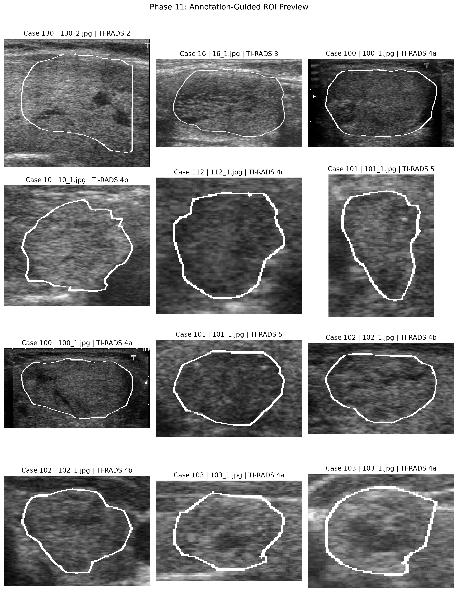</td>
<td>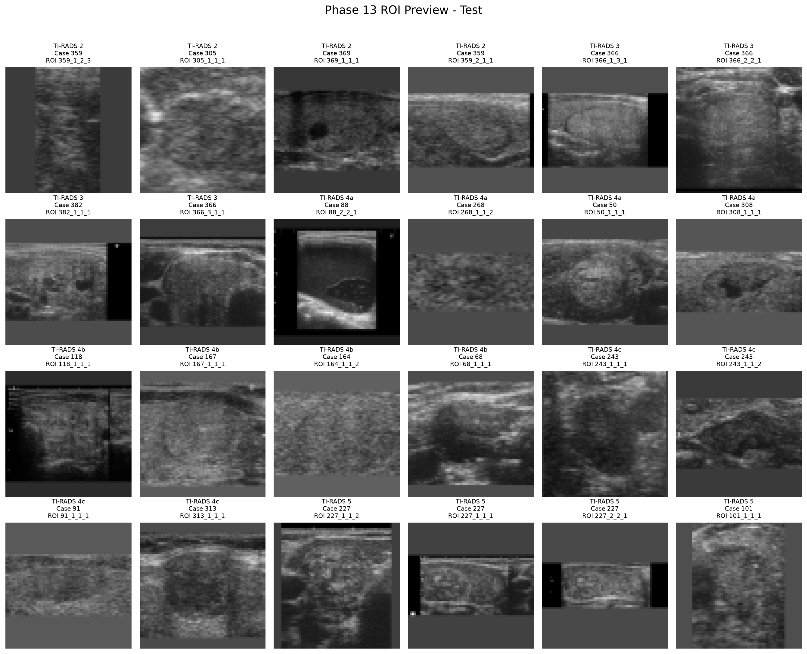</td>
</tr>
</table>

## Strict Phase 14 ROI Baseline

| Evaluation | Accuracy | Balanced Accuracy | Macro F1 |
|---|---:|---:|---:|
| ROI level | **5.63%** | 16.67% | 1.78% |
| Case level | **4.55%** | 16.67% | 1.45% |

<table>
<tr>
<td align="center"><b>Training Curves</b></td>
<td align="center"><b>ROI Confusion Matrix</b></td>
</tr>
<tr>
<td>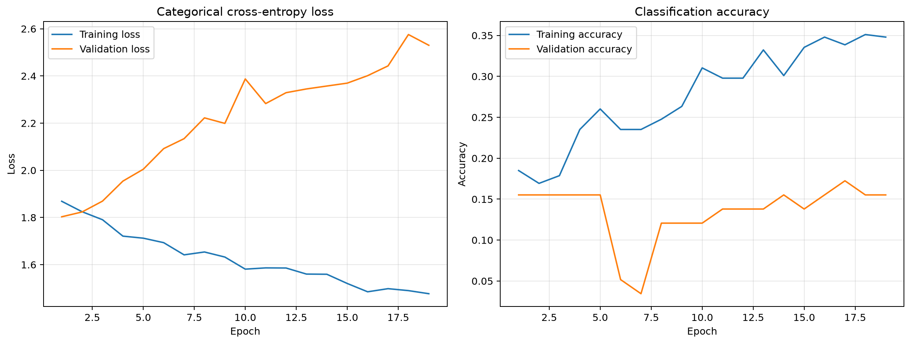</td>
<td>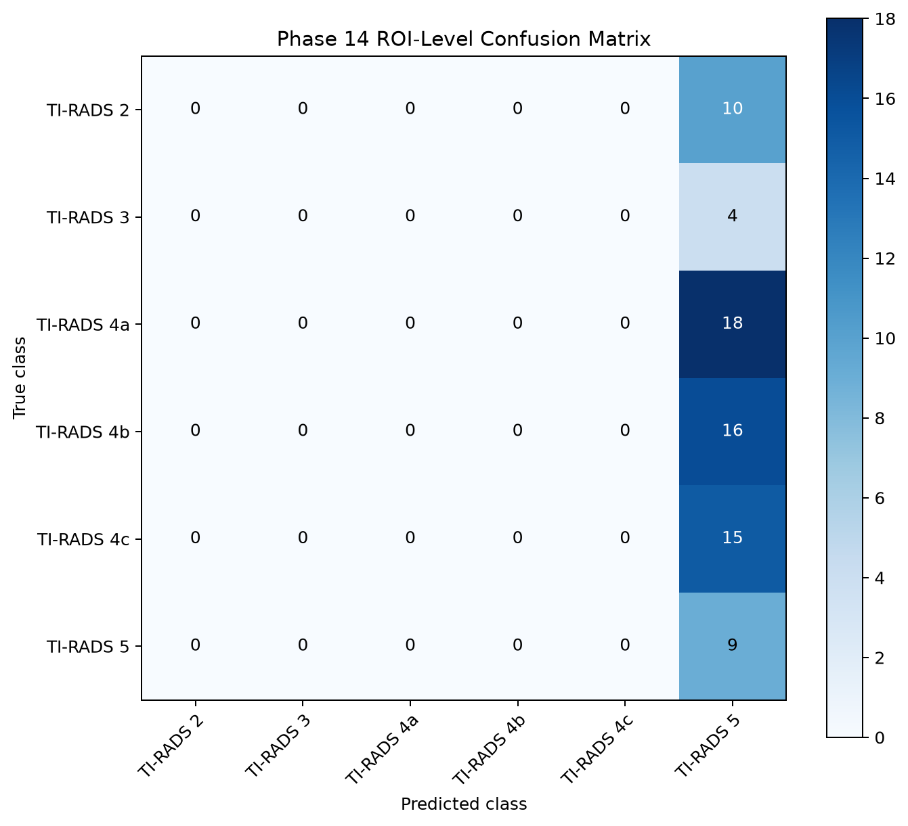</td>
</tr>
<tr>
<td colspan="2" align="center"><b>Case Confusion Matrix</b></td>
</tr>
<tr>
<td colspan="2" align="center">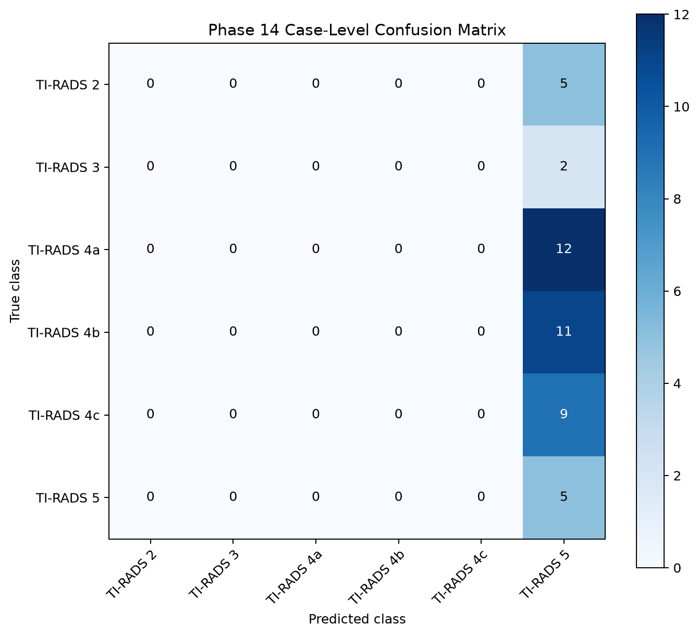</td>
</tr>
</table>

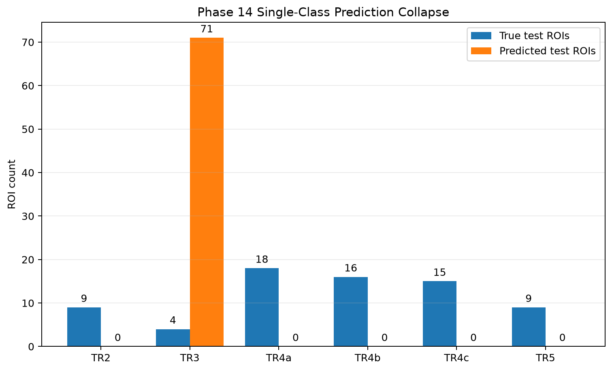

## Research Closure

Model development for the original-paper reproduction ended after Phase 14.
Phases 15-18 contain consolidation, terminology correction, paper tables, and
error analysis only. They did not train new models.

No Phase 19 experiment is part of this research release. The audited release
is **v1.2.0**.

<!-- VERIFIED_RESULTS_DASHBOARD_END -->

---

# Experimental Pipeline

The complete reproduction was performed through a structured multi-phase workflow. Every phase was independently verified before progressing to the next stage, ensuring that the final implementation remained reproducible, transparent and scientifically defensible.

```text
                     PUBLIC DDTI DATASET
                              │
                              ▼
                 Dataset Verification & Audit
                              │
                              ▼
                 XML Parsing & Metadata Extraction
                              │
                              ▼
               Master Dataset Generation (CSV)
                              │
                              ▼
              Image Inspection & Preprocessing
                              │
                              ▼
            Binary Classification Reproduction
                              │
                              ▼
         Quantum Feature Generation (QuCNet)
                              │
                              ▼
      Classical CNN & Quantum CNN Comparison
                              │
                              ▼
      Multi-Class TI-RADS Classification Study
                              │
                              ▼
         Complete Annotation & Case-Level Audit
                              │
                              ▼
        Frozen Case-ID-Disjoint Dataset Split
                              │
                              ▼
            Lesion ROI Dataset Construction
                              │
                              ▼
        Final ROI-Level & Case-Level Evaluation
                              │
                              ▼
        Scientific Analysis & Reproducibility Report
```

---

# Repository Structure

```text
QCNN_Thyroid_Paper_Reproduction
│
├── 01_Paper
│   ├── Reference paper
│   └── Supporting literature
│
├── 02_Dataset_Raw
│   └── Original DDTI dataset
│
├── 03_Dataset_Processed
│   └── Generated datasets, NumPy arrays and processed outputs
│
├── 04_Notebooks
│   └── Experimental notebooks and exploratory analysis
│
├── 05_Source_Code
│   ├── Phase-wise implementation
│   ├── Utility modules
│   └── Reproduction scripts
│
├── 06_Models
│   └── Saved TensorFlow model checkpoints
│
├── 07_Results
│   ├── Metrics
│   ├── Reports
│   ├── Confusion matrices
│   ├── Prediction files
│   └── Experimental outputs
│
├── 08_Presentation
│   └── Presentation material
│
├── 09_Output_images
│   └── Pipeline visualizations
│
├── Project_Log.txt
│
├── README.md
│
├── requirements.txt
│
└── .gitignore
```

---

# Dataset Overview

This reproduction uses the **Digital Database of Thyroid Ultrasound Images (DDTI)**, a publicly available thyroid ultrasound dataset containing expert-annotated ultrasound scans together with XML metadata describing thyroid nodules.

Unlike many benchmark datasets, the DDTI dataset contains multiple ultrasound images for several patients, XML annotation files, SVG-based lesion boundaries and TI-RADS information, making the preprocessing pipeline considerably more complex than conventional image classification datasets.

During the reproduction process, the complete dataset was independently verified before any model training was performed.

---

## Original Dataset Statistics

| Component | Count |
|-----------|------:|
| XML Files | 390 |
| Ultrasound Images | 480 |
| Images with TI-RADS Labels | 349 |
| Images without TI-RADS Labels | 131 |

---

## Audited Dataset Statistics

Following the annotation and recorded-case-ID audit performed during the later stages of this research, the retained dataset consisted of (patient uniqueness was not independently verified):

| Component | Count |
|-----------|------:|
| Valid Case IDs | 291 |
| Unique Valid ROI Geometries | 440 |
| Invalid Annotation Records | Documented Separately |

---

# Research Timeline

The reproduction study was carried out as a sequence of progressively refined experimental phases.

Rather than directly implementing the published model, the project focused on understanding every stage of the original methodology, verifying each intermediate result and correcting potential reproducibility issues whenever they were identified.

| Phase | Description | Status |
|------|-----------------------------------------------|:------:|
| Phase 0 | Dataset Verification | ✅ |
| Phase 1 | XML Structure Analysis | ✅ |
| Phase 2 | Master Dataset Generation | ✅ |
| Phase 3 | Image Inspection | ✅ |
| Phase 4 | Image Preprocessing | ✅ |
| Phase 5 | Binary Dataset Preparation | ✅ |
| Phase 6 | Initial QuCNet Baseline | ✅ |
| Phase 7 | Classical CNN Baseline | ✅ |
| Phase 8 | Multi-Class TI-RADS Study | ✅ |
| Phase 9 | Controlled Experimental Comparison | ✅ |
| Phase 10 | Evaluation & Analysis | ✅ |
| Phase 11 | Annotation Audit | ✅ |
| Phase 12 | Leakage-Free Case Split | ✅ |
| Phase 13 | ROI Dataset Generation | ✅ |
| Phase 14 | Final ROI-Level Evaluation | ✅ |

---

# Research Philosophy

Throughout this project, the primary objective was **scientific reproducibility rather than model optimisation**.

Every experimental decision was guided by the following principles:

- Preserve reproducibility over reported accuracy.
- Never modify the testing dataset after observing results.
- Freeze validated dataset splits before training.
- Preserve unsuccessful experiments as part of the research record.
- Maintain complete transparency in preprocessing and evaluation.
- Avoid undocumented modifications to the original methodology.
- Document every important experimental decision chronologically.

These principles ensured that the final conclusions were based on a scientifically rigorous experimental protocol rather than repeated optimisation attempts.

---

# Key Challenges Encountered

Reproducing the QuCNet paper required overcoming several practical challenges that were not fully described in the original publication.

The major challenges included:

- Understanding the XML annotation structure.
- Mapping XML files to corresponding ultrasound images.
- Reconstructing the complete preprocessing pipeline.
- Absence of publicly available pathology-confirmed benign/malignant labels.
- Recovering the quantum-inspired feature generation procedure.
- Reconstructing the reported model architecture.
- Managing severe class imbalance across TI-RADS categories.
- Detecting and preventing overlap of the same recorded case IDs across dataset partitions.
- Designing a clinically meaningful ROI-level evaluation protocol.
- Preserving complete reproducibility throughout every phase of development.

These challenges significantly influenced the final experimental design and motivated the later annotation audit and recorded-case-ID-disjoint evaluation protocol.

---
# Methodology

The reproduction was carried out using a structured, phase-wise methodology. Rather than implementing the complete QuCNet architecture directly, every stage of the published workflow was reconstructed independently and validated before progressing to the next phase.

This approach ensured that implementation errors, dataset inconsistencies and methodological assumptions could be identified early without affecting later experimental stages.

The complete workflow evolved through fourteen major phases, beginning with dataset verification and concluding with a frozen case-ID-separated evaluation protocol.

---

# Phase 0 — Dataset Verification

The first stage focused on understanding the publicly available DDTI dataset.

The following tasks were performed:

- Downloaded and organized the DDTI dataset.
- Verified XML annotation files.
- Verified ultrasound image availability.
- Confirmed folder organization.
- Checked XML-image correspondence.
- Verified dataset integrity.

### Outcome

The downloaded dataset contained:

| Component | Count |
|-----------|------:|
| XML Files | 390 |
| Ultrasound Images | 480 |

The dataset was successfully verified and considered suitable for further analysis.

---

# Phase 1 — XML Structure Analysis

The XML annotation files were studied in detail to understand how clinical metadata and lesion annotations were represented.

The analysis included:

- Patient metadata
- Age and gender
- Composition
- Echogenicity
- Margins
- Calcifications
- TI-RADS category
- SVG lesion annotations

### Outcome

The XML files provided rich clinical metadata together with expert-marked lesion boundaries.

This phase established the foundation for every later preprocessing step.

---

# Phase 2 — Master Dataset Generation

A complete XML parser was developed to automatically reconstruct the dataset.

The parser extracted:

- Case ID
- XML filename
- Image filename
- Image number
- Patient metadata
- TI-RADS category
- Image path
- Annotation availability

The extracted information was consolidated into structured datasets.

Generated outputs included:

- master_dataset.csv
- master_dataset.xlsx

This dataset became the primary source of metadata throughout the remaining phases.

---

# Phase 3 — Image Inspection

Before preprocessing, every ultrasound image was independently inspected.

The inspection pipeline verified:

- Image readability
- Image dimensions
- Channel consistency
- Pixel intensity distribution
- Corrupted image detection

### Outcome

All 480 ultrasound images were successfully read.

No corrupted images were detected.

The dataset showed highly consistent image dimensions, making it suitable for a unified preprocessing pipeline.

---

# Phase 4 — Image Preprocessing

A standardized preprocessing pipeline was implemented to prepare the images for model training.

The preprocessing operations included:

- Grayscale conversion
- Image resizing
- Pixel normalization
- Dataset verification
- NumPy dataset generation

Only images containing valid TI-RADS labels were retained for supervised learning.

### Final Processed Dataset

| Item | Count |
|------|------:|
| Total Images | 480 |
| Images with TI-RADS | 349 |
| Images without TI-RADS | 131 |

### Important Observation

The publicly available DDTI dataset does not contain pathology-confirmed benign and malignant labels used in the original publication.

This became one of the most important reproducibility challenges encountered during the study.

---

# Phase 5 — Binary Classification Dataset Preparation

To investigate the binary classification task described in the original paper, a provisional binary dataset was constructed.

The pipeline included:

- Binary label generation
- Stratified train-test split
- Dataset serialization
- Class distribution verification

Training data imbalance was handled using SMOTE only on the training partition. However, the 70-image holdout set was also used as validation data for early stopping and checkpoint selection during the initial Phase 6 experiment. Therefore, the resulting binary metrics must be interpreted as validation-selected holdout performance rather than evaluation on a fully independent untouched test set.

### Important Clarification

The binary labels generated during this phase were **proxy labels inferred from TI-RADS categories** and not pathology-confirmed diagnoses.

Consequently, the binary experiments should be interpreted as exploratory reproduction experiments rather than exact replications of the original pathology-based classification task.

---

# Phase 6 — Initial QuCNet Reproduction

The first implementation of the published QuCNet methodology was reconstructed.

The implementation included:

- Quantum-inspired feature generation
- Four-channel feature representation
- Dense classifier
- Early stopping
- Learning-rate scheduling
- Model checkpointing

The objective of this phase was to determine whether the reconstructed methodology could achieve performance comparable to that reported in the original publication.

Although the complete pipeline executed successfully, the reported classification accuracy was not reproduced.

---

# Phase 7 — Classical CNN Baseline

A conventional CNN baseline was implemented using the same reconstructed dataset.

The purpose of this comparison was to determine whether the observed performance limitations originated from:

- Quantum-inspired feature generation,
- Dataset quality,
- Label construction,
- or implementation differences.

The classical baseline achieved slightly better performance than the reconstructed QuCNet implementation, suggesting that the reproduction gap could not be explained solely by the quantum feature transformation.

---

# Phase 8 — Multi-Class TI-RADS Classification

The reproduction was extended from binary classification to six-class TI-RADS prediction.

The classification categories included:

- TI-RADS 2
- TI-RADS 3
- TI-RADS 4a
- TI-RADS 4b
- TI-RADS 4c
- TI-RADS 5

Both quantum-inspired and classical models were evaluated under controlled experimental conditions.

---

# Phase 9 — Controlled Comparative Evaluation

To ensure a fair comparison, both models were trained using identical experimental settings.

The following parameters remained unchanged:

- Dataset
- Train-validation split
- Optimizer
- Learning rate
- Batch size
- Number of epochs
- Early stopping strategy
- Evaluation protocol

Only the input representation differed between the two models.

This allowed the influence of the quantum-inspired feature transformation to be isolated from other implementation variables.

---

# Phase 10 — Experimental Evaluation

Detailed evaluation reports were generated, including:

- Classification reports
- Confusion matrices
- Prediction files
- Learning curves
- Performance metrics

The experiments consistently indicated that the reported paper-level performance could not be reproduced using the available public dataset.

Rather than repeatedly tuning the model, the focus shifted toward understanding why the reproduction gap existed.

---

# Transition to Scientific Audit

At this stage, it became evident that architecture optimisation alone could not explain the discrepancy between the reproduced results and those reported in the original publication.

Instead of continuing to modify the model, the research direction shifted toward auditing the dataset itself.

This decision marked the beginning of the second half of the project, which focused on annotation quality, patient-level data leakage and reproducibility analysis.

---

# Phase 11 — Case and Annotation Audit

After completing the initial reproduction and the controlled comparison between quantum-transformed features and original grayscale images, the complete experimental pipeline was reviewed again.

This review revealed an important methodological issue.

The DDTI dataset contains:

- Multiple ultrasound images for several patient cases
- Multiple annotation regions within certain images
- Multiple lesion-level samples originating from the same case

Therefore, an image-level train-test split alone could not guarantee patient-level independence.

If different images or lesion regions from the same case appear in both training and testing partitions, the evaluation may contain hidden data leakage. This can produce overestimated performance because the model may indirectly encounter patient-specific information during training.

For this reason, the earlier image-level experiments were preserved as exploratory reproduction experiments, while a stricter case-level audit was introduced for the final evaluation.

---

## Audit Objectives

The Phase 11 audit was designed to verify:

- Case-to-image relationships
- XML-to-image mappings
- Multiple images belonging to the same case
- Multiple annotation regions belonging to the same image
- Annotation coordinate validity
- Bounding-box quality
- Missing or incomplete annotation records
- Previous train-test assignments
- Case-level overlap across dataset partitions
- ROI-level overlap across dataset partitions

---

## Audit Implementation

The complete audit was performed using:

```text
05_Source_Code/phase11_case_annotation_audit.py
```

The script reconstructed the dataset at three levels:

```text
Patient Case
     │
     ├── One or More Ultrasound Images
     │
     └── One or More Annotated Lesion Regions
```

For every annotation record, the script extracted and verified:

- Case ID
- Image filename
- Image number
- TI-RADS class
- Annotation points
- Bounding-box coordinates
- ROI dimensions
- Coordinate validity
- Previous split assignment

---

## Final Audit Results

| Audit Component | Count |
|---|---:|
| Valid Case IDs | 291 |
| Unique Valid ROI Geometries | 440 |
| Invalid or Incomplete Records | Preserved Separately |

Invalid records were not silently removed.

They were documented in dedicated reports to maintain transparency and allow future researchers to inspect the exact reasons for exclusion.

A final geometry-level audit identified nine redundant ROI copies across six exact duplicate groups. These redundant copies were excluded from the strict dataset, leaving 440 unique ROI geometries. All removed records remain preserved in `duplicate_roi_geometry_records.csv`.

---

## Major Finding

The audit demonstrated that the earlier image-level split could not be treated as the final patient-independent evaluation.

Multiple images or regions originating from the same case could potentially be assigned to different dataset partitions.

The earlier experiments remain scientifically useful because they document the initial reproduction attempt and the controlled comparison between quantum and classical feature representations.

However, they are not used as the final case-ID-separated evaluation evidence.

---

## Phase 11 Generated Outputs

The audit produced:

```text
07_Results/phase11_case_annotation_audit/
```

including:

- `annotation_coverage_report.txt`
- `annotation_inventory.csv`
- `case_distribution.json`
- `duplicate_roi_geometry_records.csv`
- `case_image_mapping.csv`
- `invalid_annotation_records.csv`
- `leaking_case_details.csv`
- `phase11_audit_summary.txt`
- `previous_split_image_assignments.csv`
- `previous_split_leakage_report.txt`
- `roi_candidate_manifest.csv`
- `roi_preview_grid.png`

---

> **Research Decision**
>
> I decided not to delete, modify or hide the earlier image-level results.
>
> Instead, I preserved them as part of the complete research history and introduced a stricter case-level protocol for the final reproduction stage.

---

# Phase 12 — Leakage-Free Case-Level Split

The objective of Phase 12 was to create a train-validation-test split with disjoint recorded case IDs. Unique patient identities across different case IDs could not be confirmed from the available metadata.

Instead of splitting individual images or ROI samples, the dataset was divided using unique case IDs.

All images and lesion regions belonging to the same case were assigned to only one partition.

This prevented the same recorded case ID from appearing in multiple partitions; it does not prove patient independence across different case identifiers.

---

## Split Strategy

The split was created using the audited case and ROI manifests generated during Phase 11.

The following principles were followed:

- Every case appears in exactly one partition
- Every ROI inherits the split assignment of its parent case
- Validation data is used only for model selection
- Test data remains untouched until final evaluation
- Case assignments are frozen before model training
- No case is moved after observing performance
- Case-ID separation is prioritized over perfect class balance; patient uniqueness remains unverified

---

## Final Case Distribution

| Split | Cases |
|---|---:|
| Training | 203 |
| Validation | 44 |
| Testing | 44 |
| **Total** | **291** |

---

## Final ROI Distribution

| Split | ROIs |
|---|---:|
| Training | 311 |
| Validation | 58 |
| Testing | 71 |
| **Total** | **440** |

---

## Leakage Verification

| Comparison | Case Overlap | ROI Overlap |
|---|---:|---:|
| Train vs Validation | 0 | 0 |
| Train vs Test | 0 | 0 |
| Validation vs Test | 0 | 0 |

The final split achieved complete separation at both patient and lesion-region levels.

---

## Phase 12 Generated Outputs

The frozen split files are stored under:

```text
07_Results/phase12_case_level_split/
```

including:

- `case_level_manifest.csv`
- `split_case_assignments.csv`
- `train_cases.csv`
- `validation_cases.csv`
- `test_cases.csv`
- `train_roi_manifest.csv`
- `validation_roi_manifest.csv`
- `test_roi_manifest.csv`
- `split_distribution.json`
- `split_audit_report.txt`

---

> **Frozen Split Policy**
>
> The Phase 12 split is treated as a permanent experimental artifact.
>
> It is not reshuffled, rebalanced or modified to obtain better performance.

---

# Phase 13 — Lesion ROI Dataset Construction

The earlier experiments used complete ultrasound images.

However, the DDTI XML files contain expert-marked lesion boundaries. These annotations make it possible to construct a more focused dataset containing only the nodule region and a small amount of surrounding context.

The objective of Phase 13 was to generate a lesion-level dataset using the validated annotation records and the frozen Phase 12 case assignments.

---

## ROI Processing Procedure

For every valid annotation region, the following operations were performed:

1. Load the original ultrasound image
2. Read the expert annotation coordinates
3. Calculate the lesion bounding box
4. Add approximately 10% contextual margin
5. Crop the lesion region
6. Convert the crop to grayscale
7. Apply square padding
8. Resize the image to `64 × 64`
9. Normalize pixel values to the range `[0,1]`
10. Preserve the case ID
11. Preserve the ROI ID
12. Preserve the TI-RADS label
13. Save the sample under its frozen split

---

## Why Square Padding Was Used

Directly resizing a rectangular lesion crop may distort its geometry.

Square padding was therefore applied before resizing so that the lesion shape remained as consistent as possible while being converted into a fixed-size model input.

---

## Final ROI Dataset Shapes

| Split | Array Shape |
|---|---|
| Training | `(311, 64, 64, 1)` |
| Validation | `(58, 64, 64, 1)` |
| Testing | `(71, 64, 64, 1)` |

---

## Associated Case Counts

| Split | Cases |
|---|---:|
| Training | 203 |
| Validation | 44 |
| Testing | 44 |

---

## ROI Processing Audit

| Audit Item | Result |
|---|---:|
| Failed ROI Records | 0 |
| Case Leakage | 0 |
| ROI Leakage | 0 |

All 440 unique validated ROI geometries were processed successfully.

---

## Generated NumPy Arrays

The final arrays include:

### Training

- `X_roi_train.npy`
- `y_roi_train.npy`
- `case_ids_roi_train.npy`
- `roi_ids_train.npy`

### Validation

- `X_roi_validation.npy`
- `y_roi_validation.npy`
- `case_ids_roi_validation.npy`
- `roi_ids_validation.npy`

### Testing

- `X_roi_test.npy`
- `y_roi_test.npy`
- `case_ids_roi_test.npy`
- `roi_ids_test.npy`

---

## Phase 13 Audit Outputs

The corresponding reports are stored under:

```text
07_Results/phase13_roi_dataset/
```

including:

- `roi_dataset_summary.txt`
- `roi_dataset_distribution.json`
- `roi_dataset_audit.csv`
- `failed_roi_records.csv`
- `train_roi_preview.png`
- `validation_roi_preview.png`
- `test_roi_preview.png`

---

## Data Integrity Decisions

The following controls were applied:

- No augmentation was stored in the frozen arrays
- No SMOTE was applied before splitting
- No synthetic samples were added to validation or testing
- No test image was modified based on model performance
- All augmentation was restricted to the training pipeline
- The frozen Phase 13 arrays were preserved unchanged after validation

---

# Phase 14 — Strict Audited ROI Categorical CNN Baseline

The objective of Phase 14 was to perform one final controlled six-class TI-RADS experiment using the audited ROI dataset.

This experiment was intentionally designed as a compact and transparent baseline rather than an aggressive architecture-search exercise.

The main question was:

> **Can a conventional CNN learn a useful six-class TI-RADS decision boundary from the audited lesion-level dataset under a strict patient-independent evaluation protocol?**

---

## Classification Classes

| Encoded Class | TI-RADS Category |
|---:|---|
| 0 | TI-RADS 2 |
| 1 | TI-RADS 3 |
| 2 | TI-RADS 4a |
| 3 | TI-RADS 4b |
| 4 | TI-RADS 4c |
| 5 | TI-RADS 5 |

---

## Experimental Controls

The final experiment used:

- Frozen Phase 12 case-level split
- Frozen Phase 13 ROI arrays
- Compact CNN architecture
- Training-only augmentation
- Class weights calculated from training labels only
- No SMOTE
- No test-set tuning
- Early stopping
- Learning-rate reduction
- Validation-based checkpoint selection
- Untouched final test evaluation
- ROI-level and case-level metrics

---

## Case-Level Evaluation

Some patient cases contain multiple ROI samples.

Therefore, evaluation was performed at two levels.

### ROI-Level Evaluation

Each lesion region was treated as an independent prediction sample.

### Case-Level Evaluation

For every patient case:

1. Collect all ROI prediction probabilities
2. Average the probability vectors
3. Select the highest-probability TI-RADS class
4. Compare the aggregated prediction with the case label

This produced a case-level evaluation without counting multiple ROIs of one recorded case as independent cases.

---

## Training Behaviour

| Training Item | Result |
|---|---:|
| Completed Epochs | 19 |
| Best Validation Epoch | 1 |

Training accuracy continued to increase after the first epoch, while validation performance declined.

This pattern indicated early overfitting and weak generalization to unseen cases.

The checkpoint saved at Epoch 1 was therefore used for final testing.

---

# Strict Phase 14 Results

## ROI-Level Test Performance

| Metric | Result |
|---|---:|
| Accuracy | 5.63% |
| Balanced Accuracy | 16.67% |
| Macro Precision | 0.94% |
| Macro Recall | 16.67% |
| Macro F1-Score | 1.78% |
| Weighted F1-Score | 0.60% |
| Cohen's Kappa | 0.000 |
| Quadratic Weighted Kappa | 0.000 |
| Mean Absolute Class Error | 1.972 |
| Test Loss | 1.818729 |

---

## Case-Level Test Performance

| Metric | Result |
|---|---:|
| Accuracy | 4.55% |
| Balanced Accuracy | 16.67% |
| Macro Precision | 0.76% |
| Macro Recall | 16.67% |
| Macro F1-Score | 1.45% |
| Weighted F1-Score | 0.40% |
| Cohen's Kappa | 0.000 |
| Quadratic Weighted Kappa | 0.000 |
| Mean Absolute Class Error | 1.955 |

---

## Final Model Observation

The final CNN failed to learn a reliable six-class TI-RADS decision boundary.

Predictions largely collapsed toward a single class, resulting in balanced accuracy close to random-choice performance for six classes.

The growing difference between training and validation performance showed that the model was memorizing limited training patterns rather than learning features that generalized to unseen patient cases.

---

# Controlled Quantum vs Classical Comparison

Before the final case-level audit, a controlled six-class experiment was performed using the earlier image-level dataset.

Both models used:

- The same training samples
- The same validation indices
- The same test set
- The same optimizer
- The same learning rate
- The same batch size
- The same class weights
- The same evaluation protocol

Only the input representation differed.

---

## Comparison Results

| Model | Accuracy | Balanced Accuracy | Macro F1 | Weighted F1 |
|---|---:|---:|---:|---:|
| Quantum-Feature QuCNet | 18.57% | 15.16% | 6.72% | 8.74% |
| Classical Grayscale CNN | 24.29% | 28.09% | 23.18% | 22.76% |
| Majority-Class Baseline | 27.14% | — | — | — |

---

## Interpretation

The classical model outperformed the reconstructed quantum-feature model across balanced accuracy, Macro F1 and Weighted F1.

The quantum model showed near-prediction collapse and used only a limited subset of the six output classes.

The classical model predicted all six classes and demonstrated better class-wise behaviour, although its overall accuracy remained below the majority-class baseline.

Under the reconstructed and controlled conditions, the quantum-transformed features did not demonstrate an advantage over original grayscale ultrasound images.

---

# Scientific Interpretation of the Strict Phase 14 Result

The final result should not be interpreted as a software implementation failure.

The complete pipeline executed successfully:

- Dataset parsing succeeded
- XML extraction succeeded
- Annotation validation succeeded
- Case mapping succeeded
- Leakage detection succeeded
- Case-level splitting succeeded
- ROI extraction succeeded
- Dataset serialization succeeded
- Model training succeeded
- Checkpoint selection succeeded
- Test evaluation succeeded
- All required metrics and reports were generated

The low final performance is therefore preserved as a valid experimental finding produced under a strict and reproducible evaluation protocol.

---

# Why the Reported Performance Could Not Be Reproduced

The reproduction gap is likely associated with a combination of several factors.

## 1. Missing Pathology-Confirmed Labels

The public DDTI dataset did not provide the exact benign/malignant pathology mapping required for the binary task described in the reference paper.

The earlier binary labels were therefore provisional TI-RADS-derived proxy labels and cannot be treated as equivalent to pathology-confirmed ground truth.

---

## 2. Possible Dataset Version or Subset Difference

The publicly recovered dataset contained:

- 480 ultrasound images
- 390 XML case files

These values differed from the dataset description reported in the paper.

This suggests that the authors may have used:

- A different dataset version
- A filtered subset
- Additional clinical records
- Private institutional mappings
- Different sample-selection rules

---

## 3. Incomplete Sample-Selection Details

The publication did not fully explain:

- Which exact cases were selected
- Which images were excluded
- How multiple images from one case were handled
- How multiple nodules were handled
- How missing labels were treated
- How invalid annotation regions were handled

These decisions can significantly affect the final dataset.

---

## 4. Unspecified Patient-Level Split

The paper did not provide enough information to reconstruct the exact patient-level train-test split.

An image-level split may introduce case leakage when several images belong to one patient.

The final reproduction therefore used a stricter patient-independent split, which may be more difficult but is methodologically safer.

---

## 5. Incomplete Quantum-Circuit Specification

The publication described the quantum-inspired transformation conceptually but did not provide every implementation detail required for exact reconstruction.

Unspecified details included:

- Exact circuit construction
- Gate ordering
- Parameter initialization
- Random-circuit generation
- Number of circuit repetitions
- Seed values
- Feature aggregation
- Measurement handling

The implemented quantum transformation is therefore a faithful reconstruction attempt, but not a guaranteed byte-for-byte reproduction of the authors' private implementation.

---

## 6. Incomplete Model and Training Details

Several training details required interpretation, including:

- Exact CNN layer configuration
- Initialization strategy
- Regularization
- Optimizer settings
- Augmentation procedure
- Checkpoint criteria
- Early-stopping configuration
- Random seeds
- Hyperparameter-selection process

Small differences in these settings may substantially affect results on a small medical imaging dataset.

---

## 7. Severe Class Imbalance

The six TI-RADS categories were not equally represented.

Minority classes contained limited training samples, making it difficult for the model to learn stable and generalizable patterns.

---

## 8. Visual Similarity Between Adjacent TI-RADS Categories

Adjacent TI-RADS categories may contain highly similar ultrasound characteristics.

For example:

- TI-RADS 4a and 4b
- TI-RADS 4b and 4c
- TI-RADS 4c and 5

Distinguishing these categories may require richer clinical context, larger datasets or expert-engineered features beyond the available image information.

---

# Final Reproduction Finding

The QuCNet methodology was systematically reconstructed and evaluated using the publicly recoverable DDTI dataset.

The research successfully produced:

- A complete dataset parser
- A validated metadata pipeline
- A quantum-inspired feature-generation workflow
- Classical and quantum model comparisons
- A complete annotation audit
- A recorded-case-ID-disjoint split
- An expert-annotation-based ROI dataset
- ROI-level and case-level evaluation
- Complete reports, predictions and metrics

However, the high classification performance reported in the original publication could not be independently reproduced.

---

> **Final Research Conclusion**
>
> The available public dataset and the methodological details disclosed in the original paper were insufficient to reproduce the reported QuCNet performance.
>
> Under controlled comparison, quantum-transformed features did not outperform original grayscale ultrasound images.
>
> Under the final case-separated protocol, the six-class model performed poorly on held-out case IDs.
>
> These results are preserved as a transparent negative reproduction finding rather than hidden through repeated model tuning.

---

# Reproduction Closure Decision

After Phase 14, the original-paper reproduction was formally closed.

I decided not to continue adding architectures merely to search for a higher accuracy value.

Doing so would change the objective from scientific reproduction to performance optimization and would weaken the clarity of the study.

Therefore:

- The original-paper reproduction is considered complete
- The negative findings are preserved
- The case-ID-separated result is retained as the strict historical evaluation, not a source-exact numerical reproduction
- Earlier image-level experiments remain part of the historical research record
- Future improvements will be presented separately as extension work
- No further model will be presented as part of the original QuCNet reproduction

---

# Research Integrity and Scope

This repository documents both the successful technical reconstruction and the unsuccessful reproduction of the reported performance.

The purpose of retaining the complete experimental history is to make clear:

- Which parts of the published workflow could be reconstructed
- Which details required interpretation
- Which dataset limitations affected the study
- Which earlier experiments contained methodological risks
- Which final results were produced under the recorded-case-ID-separated protocol
- Why the reported performance could not be independently verified

No experiment has been removed solely because it produced low accuracy.

No final test split was modified after observing model performance.

No additional architecture is presented as part of the original-paper reproduction after the formal closure of Phase 14.

This distinction protects the difference between:

1. **Reproducing the published QuCNet study**, and
2. **Developing a new model inspired by the reproduction findings**

Any future architecture, ordinal-learning method or performance-improvement study will therefore be documented separately as an extension and will not be presented as reproduced evidence from the original paper.

---

# Citation

## Citing This Repository

GitHub provides machine-readable citation metadata through the repository's
[`CITATION.cff`](CITATION.cff) file.

After the file is available on the default branch, GitHub will display a
**Cite this repository** option in the repository sidebar.
[Reference Paper DOI](https://doi.org/10.1109/ACCESS.2024.3367806)

This repository is part of an academic reproduction study conducted for postgraduate research.

Until a formal thesis or associated research article is published, the repository may be cited as:

> **Karthik B. R.**  
> *Reproduction and Methodological Audit of QuCNet for Thyroid Nodule Classification*.  
> GitHub repository, 2026.  
> Available at: [github.com/karthikaxiom/QCNN_Thyroid_Paper_Reproduction](https://github.com/karthikaxiom/QCNN_Thyroid_Paper_Reproduction)

### BibTeX

```bibtex
@software{karthik_2026_qucnet_reproduction,
  author       = {Karthik B. R.},
  title        = {Reproduction and Methodological Audit of QuCNet
                  for Thyroid Nodule Classification},
  year         = {2026},
  publisher    = {GitHub},
  url          = {https://github.com/karthikaxiom/QCNN_Thyroid_Paper_Reproduction},
  note         = {Independent reproduction and methodological audit
                  using the publicly available DDTI dataset}
}
```

> [!NOTE]
> The citation information may be updated after the completion of the M.Tech thesis or publication of an associated research article.

---

# References

<a id="references"></a>

[1] G. Swathi, A. Altalbe and R. P. Kumar,  
“QuCNet: Quantum-Inspired Convolutional Neural Networks for Optimized Thyroid Nodule Classification,”  
*IEEE Access*, vol. 12, pp. 27829–27842, 2024.  
[https://doi.org/10.1109/ACCESS.2024.3367806](https://doi.org/10.1109/ACCESS.2024.3367806)

---

# Researcher

<table>
<tr>
<td>

## Karthik B. R.

**M.Tech — Information Technology**  
**University Visvesvaraya College of Engineering**  
**Bengaluru, Karnataka, India**

</td>
</tr>
</table>

I undertook this project as an independent reproduction and methodological audit of quantum-inspired thyroid ultrasound classification.

My contribution covered the complete research lifecycle, including:

- Literature analysis
- Dataset recovery and verification
- XML annotation parsing
- Image and metadata preprocessing
- Quantum-inspired feature reconstruction
- Classical and quantum model implementation
- Binary and multi-class experimentation
- Annotation and recorded-case-ID leakage auditing; patient identity remains unverified
- Case-independent dataset splitting
- Lesion ROI construction
- ROI-level and case-level evaluation
- Reproducibility analysis
- Experimental documentation
- Repository development

The central aim of this work was not to reproduce a high number by repeated tuning, but to determine whether the published findings could be recovered under transparent and independently verifiable conditions.

### Research Interests

- Artificial Intelligence and Machine Learning
- Medical Image Analysis
- Quantum Machine Learning
- Deep Learning
- Scientific Reproducibility
- Computer Vision

### Research Profiles

| Platform | Link |
|---|---|
| GitHub | [karthikaxiom](https://github.com/karthikaxiom) |
| Repository | [QCNN Thyroid Paper Reproduction](https://github.com/karthikaxiom/QCNN_Thyroid_Paper_Reproduction) |

---

# Academic Context

| Field | Details |
|---|---|
| Researcher | Karthik B. R. |
| Programme | Master of Technology |
| Specialization | Information Technology |
| Institution | University Visvesvaraya College of Engineering |
| Location | Bengaluru, Karnataka, India |
| Research Area | Quantum-Inspired Medical Image Classification |
| Study Type | Independent Reproduction and Methodological Audit |
| Dataset | Digital Database of Thyroid Ultrasound Images |
| Reference Model | QuCNet |
| Project Status | Reproduction Completed |
| Completion Year | 2026 |

---

# Acknowledgements

I acknowledge the authors of the original QuCNet study for introducing the quantum-inspired thyroid nodule classification framework investigated in this project.

I also acknowledge the researchers and medical experts involved in creating and annotating the DDTI dataset. Their work made this independent study possible.

This repository is maintained for academic, educational and reproducibility-oriented research purposes.

---

# Disclaimer

This project is intended exclusively for research and educational use.

The models, outputs and findings contained in this repository:

- Are not medical devices
- Have not been clinically validated
- Must not be used for diagnosis
- Must not replace professional medical judgement
- Must not be used to make patient-care decisions

The TI-RADS predictions generated during this research are experimental machine-learning outputs and should not be interpreted as clinical assessments.

---

<div align="center">

## Reproducibility Before Performance

**A negative result documented honestly is more valuable than a high result that cannot be independently verified.**

<br>

Developed and documented by **Karthik B R.**
</div>

---


# Installation and Environment Setup

This repository was developed and tested using a Python virtual environment on Windows.

The project should be executed from the repository root so that all relative paths remain valid.

---

## System Requirements

Recommended minimum environment:

| Requirement | Recommended Configuration |
|---|---|
| Operating System | Windows 10 or later |
| Python | Python 3.13 |
| RAM | 8 GB or more |
| Storage | At least 5 GB of free space |
| GPU | Not required |
| Internet | Required only for initial package installation |
| IDE | Visual Studio Code or equivalent |

The project can be executed on a CPU-only system.

However, model training time may vary depending on processor speed, memory availability and TensorFlow configuration.

---

## Clone the Repository

```bash
git clone https://github.com/Robbin808/QCNN_Thyroid_Paper_Reproduction.git
```

Move into the project directory:

```bash
cd QCNN_Thyroid_Paper_Reproduction
```

---

## Create a Virtual Environment

### Windows PowerShell

```powershell
py -3.13 -m venv .venv
```

Activate the environment:

```powershell
.\.venv\Scripts\Activate.ps1
```

After successful activation, the terminal should display:

```text
(.venv)
```

---

## PowerShell Execution Policy

If PowerShell prevents activation of the virtual environment, run:

```powershell
Set-ExecutionPolicy -Scope Process -ExecutionPolicy Bypass
```

Then activate the environment again:

```powershell
.\.venv\Scripts\Activate.ps1
```

This changes the execution policy only for the current PowerShell session.

---

## Install Dependencies

Upgrade `pip` first:

```powershell
python -m pip install --upgrade pip
```

Install the required packages:

```powershell
pip install -r requirements.txt
```

---

## Verify the Python Interpreter

The project should use the interpreter inside `.venv`.

Check the active Python path:

```powershell
where.exe python
```

The expected interpreter should point to:

```text
QCNN_Thyroid_Paper_Reproduction\.venv\Scripts\python.exe
```

Check the Python version:

```powershell
python --version
```

Expected output:

```text
Python 3.13.x
```

---

## Verify TensorFlow

Run:

```powershell
python -c "import tensorflow as tf; print(tf.__version__)"
```

Verify NumPy:

```powershell
python -c "import numpy as np; print(np.__version__)"
```

Verify OpenCV:

```powershell
python -c "import cv2; print(cv2.__version__)"
```

Verify Scikit-learn:

```powershell
python -c "import sklearn; print(sklearn.__version__)"
```

---

> [!IMPORTANT]
> Do not run the source files using the VS Code **Run and Debug** button.
>
> Activate the virtual environment and execute each script directly from the terminal.
>
> This avoids interpreter mismatch, relative-path errors and package-resolution problems.

---

# Dataset Preparation

**Dataset-release correction (28 October 2026):** This public repository **currently includes 480 tracked ultrasound JPGs and 390 XML files** under `02_Dataset_Raw/archive/`. The earlier claim that the raw DDTI dataset was not redistributed was incorrect. Source-data redistribution permission and any identifying content in images/XML remain unverified. The repository's MIT software license **does not establish** rights over third-party clinical data. See [release decision](Research_Extension/DATA_RELEASE_PERMISSION_DECISION.md) before reusing or sharing the source files. `.gitignore` does not remove files from the history; no destructive change has been made.

Users must obtain the dataset separately and place it inside the expected raw-data directory.

The raw dataset should be stored under:

```text
02_Dataset_Raw/
```

A typical arrangement may look like:

```text
02_Dataset_Raw/
│
├── archive/
│   ├── XML files
│   ├── ultrasound images
│   └── dataset folders
│
└── README or source information
```

The exact internal structure should remain consistent with the paths expected by the phase-wise scripts.

---

> [!CAUTION]
> Do not modify image filenames, XML filenames or case identifiers before running the parsing and audit scripts.
>
> The project depends on preserving the original relationships between:
>
> - XML records
> - case IDs
> - image numbers
> - ultrasound files
> - lesion annotations

---

# Execution Strategy

This repository is organized as a sequential research pipeline.

The scripts should be executed phase by phase because later stages depend on outputs produced during earlier stages.

The recommended workflow is:

```text
Raw Dataset
     │
     ▼
Dataset Verification
     │
     ▼
XML and Metadata Parsing
     │
     ▼
Processed Dataset Generation
     │
     ▼
Initial Reproduction Experiments
     │
     ▼
Controlled Classical and Quantum Comparison
     │
     ▼
Annotation Audit
     │
     ▼
Leakage-Free Case Split
     │
     ▼
ROI Dataset Construction
     │
     ▼
Final Leakage-Free Evaluation
```

---

# Running the Source Code

All commands should be executed from the repository root.

General command format:

```powershell
python .\05_Source_Code\<script_name>.py
```

A fully explicit interpreter path may also be used:

```powershell
.\.venv\Scripts\python.exe .\05_Source_Code\<script_name>.py
```

Using the explicit interpreter is useful when multiple Python installations are present on the system.

---

# Recommended Phase-Wise Execution

The exact filenames inside `05_Source_Code` should be followed as stored in the repository.

The general phase order is:

| Order | Research Stage |
|---:|---|
| 1 | Dataset Verification |
| 2 | XML Structure Analysis |
| 3 | Master Dataset Generation |
| 4 | Image Inspection |
| 5 | Image Preprocessing |
| 6 | Binary Dataset Preparation |
| 7 | Initial QuCNet Reproduction |
| 8 | Classical CNN Baseline |
| 9 | Multi-Class TI-RADS Experiment |
| 10 | Controlled Evaluation |
| 11 | Case and Annotation Audit |
| 12 | Leakage-Free Case-Level Split |
| 13 | ROI Dataset Construction |
| 14 | Final Leakage-Free CNN Evaluation |

---

## Example Command

For a source file stored as:

```text
05_Source_Code/phase11_case_annotation_audit.py
```

run:

```powershell
python .\05_Source_Code\phase11_case_annotation_audit.py
```

For the explicit virtual-environment interpreter:

```powershell
.\.venv\Scripts\python.exe .\05_Source_Code\phase11_case_annotation_audit.py
```

---

# Important Execution Rules

To preserve the original research protocol:

1. Run the scripts from the repository root.
2. Do not rename dataset folders after preprocessing begins.
3. Do not manually edit generated manifests.
4. Do not reshuffle the frozen Phase 12 case split.
5. Do not modify the final test partition.
6. Do not overwrite results without preserving the previous outputs.
7. Do not apply SMOTE to validation or test data.
8. Do not add test samples to training after observing results.
9. Do not tune the model using final test metrics.
10. Record any methodological change in `Project_Log.txt`.

---

# Generated Data Locations

The project stores outputs according to their function.

## Processed Data

```text
03_Dataset_Processed/
```

This folder may contain:

- Processed image arrays
- Encoded labels
- Train-validation-test arrays
- ROI datasets
- Case IDs
- ROI IDs
- Intermediate manifests
- Serialized NumPy files

---

## Saved Models

```text
06_Models/
```

This folder may contain:

- TensorFlow model checkpoints
- Best validation checkpoints
- Final saved models
- Training configuration artifacts

---

## Experimental Results

```text
07_Results/
```

This folder contains the primary scientific evidence generated by the project.

Typical outputs include:

- Classification reports
- Confusion matrices
- Prediction CSV files
- Training histories
- Evaluation summaries
- Split audits
- Annotation reports
- Leakage reports
- ROI manifests
- Dataset distributions
- Failed-record reports

---

## Output Images

```text
09_Output_images/
```

This folder is used for visual research outputs such as:

- Sample ultrasound visualizations
- ROI previews
- Feature maps
- Confusion matrices
- Training curves
- Pipeline diagrams
- Dataset illustrations

Additional README figures will be added here later and linked directly from this document.

---

# Reproducing the Strict Audited ROI Baseline

The final scientifically preferred experiment begins from the Phase 11 annotation audit and continues through Phase 14.

The required sequence is:

```text
Phase 11 — Case and Annotation Audit
          │
          ▼
Phase 12 — Frozen Leakage-Free Case Split
          │
          ▼
Phase 13 — ROI Dataset Construction
          │
          ▼
Phase 14 — Final Categorical CNN Evaluation
```

---

## Step 1 — Run the Annotation Audit

```powershell
python .\05_Source_Code\phase11_case_annotation_audit.py
```

Expected outcome:

- Case-image relationships reconstructed
- ROI candidates validated
- Invalid annotations recorded
- Previous leakage risks documented
- Audited manifests generated

---

## Step 2 — Generate the Frozen Case-Level Split

Run the corresponding Phase 12 script stored in:

```text
05_Source_Code/
```

Expected outcome:

| Split | Cases | ROIs |
|---|---:|---:|
| Training | 203 | 311 |
| Validation | 44 | 58 |
| Testing | 44 | 71 |

Expected leakage result:

```text
Case overlap: 0
ROI overlap: 0
```

---

## Step 3 — Construct the ROI Dataset

Run the corresponding Phase 13 ROI dataset script.

Expected array shapes:

```text
Training:   (311, 64, 64, 1)
Validation: (58, 64, 64, 1)
Testing:    (71, 64, 64, 1)
```

Expected failed ROI records:

```text
0
```

---

## Step 4 — Run the Final CNN Evaluation

Run the corresponding Phase 14 training and evaluation script.

Expected training behaviour:

```text
Best validation epoch: 1
Training stopped: Epoch 19
```

The final result files should be written under:

```text
07_Results/phase14_roi_categorical_baseline/
```

or the matching Phase 14 result directory present in the repository.

---

# Expected Strict Phase 14 Metrics

The reproduced results may differ slightly depending on:

- TensorFlow version
- CPU architecture
- Random-number implementation
- Operating system
- Package versions
- Hardware-level numerical behaviour

However, the overall scientific conclusion should remain unchanged.

The recorded final evaluation produced:

## ROI-Level

| Metric | Recorded Result |
|---|---:|
| Accuracy | 5.63% |
| Balanced Accuracy | 16.67% |
| Macro F1 | 1.78% |
| Weighted F1 | 0.60% |
| Quadratic Weighted Kappa | 0.000 |
| Mean Absolute Class Error | 1.972 |

## Case-Level

| Metric | Recorded Result |
|---|---:|
| Accuracy | 4.55% |
| Balanced Accuracy | 16.67% |
| Macro F1 | 1.45% |
| Weighted F1 | 0.40% |
| Quadratic Weighted Kappa | 0.000 |
| Mean Absolute Class Error | 1.955 |

---

> [!NOTE]
> Exact floating-point values may vary across environments.
>
> Reproducibility should therefore be assessed using:
>
> - dataset counts,
> - split integrity,
> - array shapes,
> - leakage results,
> - training behaviour,
> - prediction patterns,
> - and the overall experimental conclusion,
>
> rather than requiring bit-for-bit equality of every metric.

---

# Result Verification Checklist

After completing the final pipeline, verify the following:

- [ ] 291 valid case IDs are present
- [ ] 440 unique ROI geometries are present
- [ ] Training split contains 203 cases
- [ ] Validation split contains 44 cases
- [ ] Test split contains 44 cases
- [ ] Training split contains 311 ROIs
- [ ] Validation split contains 58 ROIs
- [ ] Test split contains 71 ROIs
- [ ] No case overlap exists
- [ ] No ROI overlap exists
- [ ] No failed ROI records exist
- [ ] Test data remains untouched during training
- [ ] ROI-level metrics are generated
- [ ] Case-level metrics are generated
- [ ] Confusion matrices are saved
- [ ] Prediction files are saved
- [ ] Final reports are written to `07_Results`

---

# Research Log

A complete chronological record of the project is available in:

```text
Project_Log.txt
```

The log documents:

- Dataset recovery
- Initial implementation decisions
- Errors and corrections
- Model experiments
- Reproduction failures
- Methodological concerns
- Annotation audit
- Leakage investigation
- Frozen split creation
- ROI dataset construction
- Final evaluation
- Reproduction closure decision

Researchers attempting to understand the development history should read the project log together with this README.

---

# Troubleshooting

## Virtual Environment Is Not Active

Check whether the terminal begins with:

```text
(.venv)
```

If not, run:

```powershell
.\.venv\Scripts\Activate.ps1
```

---

## Python Uses the Wrong Interpreter

Run:

```powershell
where.exe python
```

Then execute the script explicitly using:

```powershell
.\.venv\Scripts\python.exe .\05_Source_Code\<script_name>.py
```

---

## Module Not Found

Example:

```text
ModuleNotFoundError
```

Install the missing dependencies again:

```powershell
pip install -r requirements.txt
```

Verify that the virtual environment is active before installation.

---

## File or Folder Not Found

Example:

```text
FileNotFoundError
```

Confirm that:

- The command is executed from the repository root
- The raw dataset exists under `02_Dataset_Raw`
- The expected processed files have already been generated
- Earlier phases were completed successfully
- Folder names were not changed

---

## TensorFlow Import Error

Check the installed version:

```powershell
pip show tensorflow
```

Reinstall dependencies if necessary:

```powershell
pip install --upgrade --force-reinstall -r requirements.txt
```

---

## Memory Error

If the system runs out of memory:

- Close unnecessary applications
- Restart the terminal
- Reduce non-essential background processes
- Confirm that large arrays are not loaded multiple times
- Run only one training process at a time

The final pipeline was designed to remain practical on an 8 GB RAM system, although training speed may be limited.

---

## Results Differ from Recorded Metrics

Small numerical differences may be caused by nondeterministic operations.

Before concluding that the reproduction failed, verify:

- Dataset version
- Dataset counts
- Package versions
- Split manifests
- Case overlap
- ROI overlap
- Label encoding
- Random seeds
- Model checkpoint selection
- Test evaluation procedure

The frozen split files and generated reports should be treated as the primary reproducibility artifacts.

---

# Reproducibility Boundaries

This repository supports reproduction of the implementation and audit performed in this study.

It cannot guarantee exact reproduction of the original QuCNet publication because the following were not publicly recoverable in complete form:

- Exact pathology-confirmed label mapping
- Exact dataset subset
- Exact patient-level split
- Complete quantum-circuit source code
- Complete preprocessing configuration
- Exact random seeds
- Full model-training configuration
- Private implementation decisions

Therefore, this repository reproduces the published methodology as faithfully as possible using the available public evidence, while clearly documenting all assumptions and deviations.

---

# Recommended Reading Order

For a complete understanding of the project, review the repository in the following order:

1. `README.md`
2. `Project_Log.txt`
3. `01_Paper/`
4. `05_Source_Code/`
5. `07_Results/phase11_case_annotation_audit/`
6. `07_Results/phase12_case_level_split/`
7. `07_Results/phase13_roi_dataset/`
8. Final Phase 14 results
9. `03_Dataset_Processed/` manifests and arrays

This sequence provides both the scientific motivation and the complete experimental evidence.

---

# Extension Study: Reproducibility and Model Sensitivity

The strict case-separated Phase 12–14 evaluation was extended through training-only experiments examining feature representation, preprocessing sensitivity, fixed quantum feature maps, and dataset integrity. These extensions leave the original data splits, saved models, historical results, and original repository log unchanged.

## Data and Evaluation Scope

The extension uses **311 ultrasound ROIs from 203 case IDs** and fivefold case-stratified cross-validation. All ROIs from a case remain within one fold; preprocessing and classification are fitted on each fold's training partition only. Case predictions are obtained from the mean of the ROI class probabilities.

Source labels represent **TI-RADS 2, 3, 4a, 4b, 4c and 5**. Historical binary labels are derived *suspicion proxies*, not independently verified histopathology outcomes. Case-ID separation does not prove patient identity uniqueness. Historical test findings were already inspected and were not reused for extension model selection.

## Verified Case-Level Results

| Development comparison | Correct / 203 cases | Accuracy | Balanced accuracy | Macro-F1 |
| --- | ---: | ---: | ---: | ---: |
| Majority-class baseline | 57 | 28.08% | 16.67% | 7.31% |
| Image features | 45 | 22.17% | 20.10% | 19.75% |
| ROI geometry features | 39 | 19.21% | 22.70% | 17.84% |
| Image + geometry fusion | 46 | 22.66% | 21.17% | 20.41% |
| Reflection-padded image features | 51 | 25.12% | 22.76% | 22.30% |
| Direct-resized image features | 57 | 28.08% | 27.53% | 26.83% |
| Classical 64-feature map | 54 | 26.60% | 25.22% | 24.26% |
| Fixed simulated quantum 64-feature map | 43 | 21.18% | 21.91% | 20.68% |

## Extension Visual Evidence

These colour vector figures reproduce the saved training-fold results. They use case-level predictions and exploratory intervals; none represents a new independent test-set benchmark. The original grayscale experimental exports remain unchanged in `07_Results/`.

<table>
<tr>
<td align="center"><b>Fixed Quantum vs Classical Features</b></td>
<td align="center"><b>ROI Preprocessing Sensitivity</b></td>
</tr>
<tr>
<td>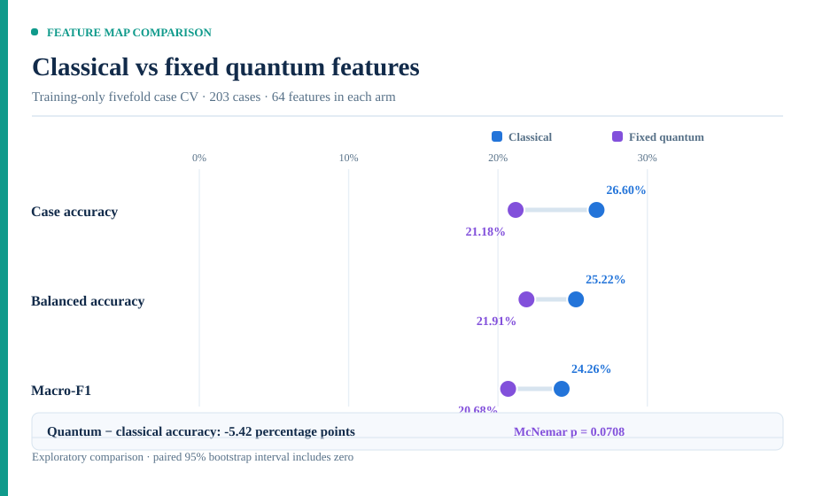</td>
<td>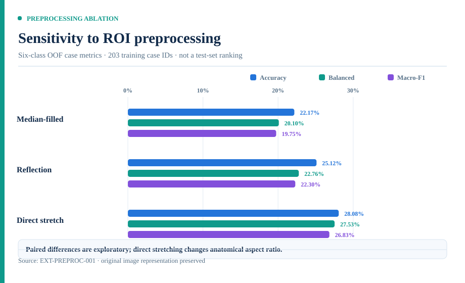</td>
</tr>
<tr>
<td align="center"><b>Padding and Predictive Log-Loss</b></td>
<td align="center"><b>Paired Fusion Accuracy Differences</b></td>
</tr>
<tr>
<td>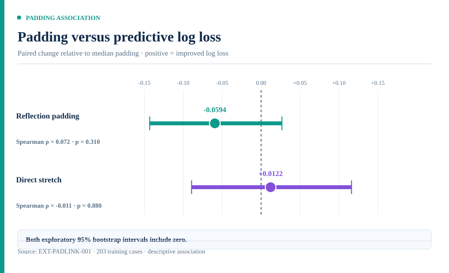</td>
<td>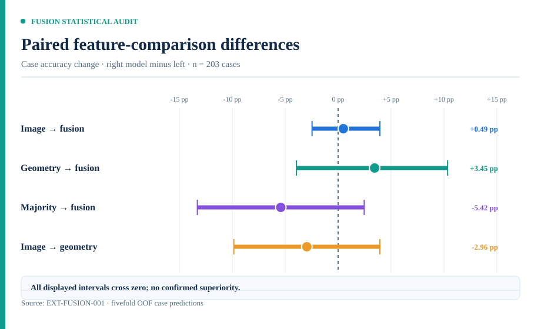</td>
</tr>
</table>


Rows belong to different **exploratory** controlled comparisons and must not be treated as confirmatory ranking over an independent test set. The matched feature-map comparison gave a quantum-minus-classical case accuracy difference of **−5.42 percentage points** (case-bootstrap 95% interval **−10.84 to 0.00** percentage points; exact McNemar **p = 0.0708**). Its four-qubit, two-layer circuit was a *fixed* simulated map, not an optimized end-to-end quantum CNN.

The original median-filled ROI preprocessing was reconstructed with **zero pixel discrepancy**. Median theoretical square-padding area was **25.6%** across the training ROIs. Alternative reflection padding and anisotropic direct resizing changed accuracy and class-balanced metrics, without a statistically established paired improvement. Padding fraction was not meaningfully associated with predictive log-loss gain. Direct resizing distorts lesion aspect ratio.

## Architecture and Class-Level Evaluation

The models below use distinct input representations and evaluation protocols. The architecture diagram separates the historical full-image quantum CNN, the strict cropped-ROI CNN, and the later matched case-fold comparisons; their accuracies should not be ranked as if they shared one test set.

<p align="center">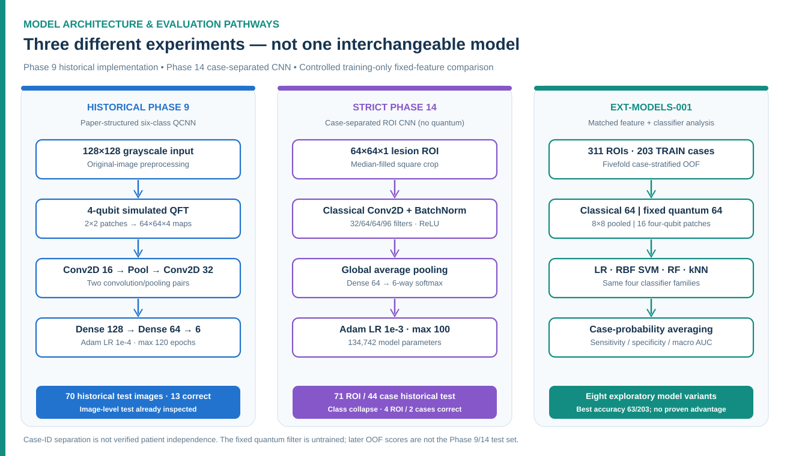</p>

The source-backed ROC-AUC analysis uses **six TI-RADS one-versus-rest classification tasks** on out-of-fold case probabilities. It is not a benign/malignant diagnosis ROC or an independent clinical test. For the classical logistic and fixed quantum random-forest models, macro one-versus-rest AUC was **0.592** and **0.607**, respectively. The random forest's higher overall accuracy masks **0% sensitivity for TI-RADS 3 (0/10 cases)**.

<table>
<tr>
<td align="center"><b>One-vs-rest ROC curves by TI-RADS category</b></td>
<td align="center"><b>Sensitivity by TI-RADS category</b></td>
</tr>
<tr>
<td>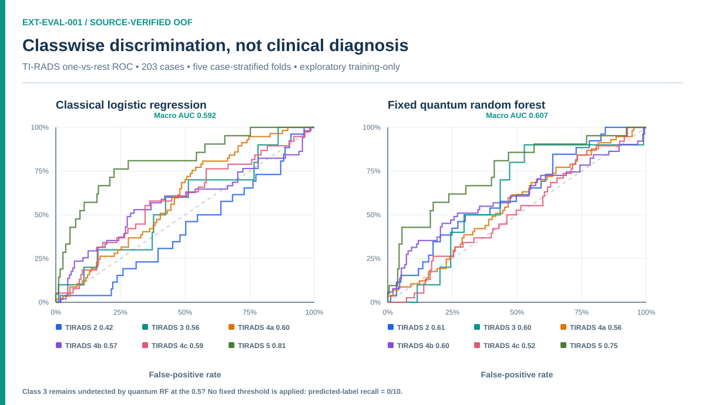</td>
<td>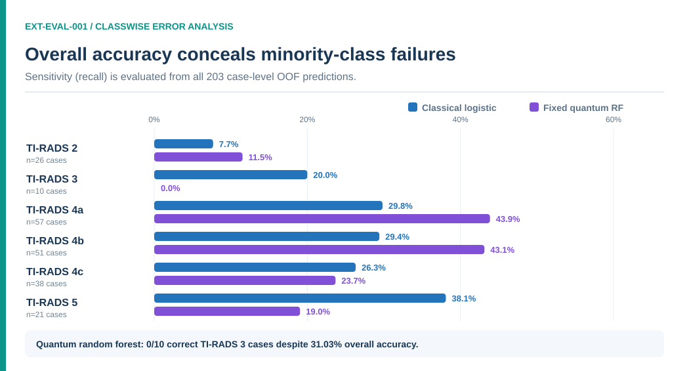</td>
</tr>
</table>

Detailed [per-class sensitivity, specificity and ROC-AUC](07_Results/exp_eval_001/class_sensitivity_specificity.csv) and the [full eight-model calculation record](07_Results/exp_eval_001/guide_metrics.json) are preserved. All curves are descriptive training-fold analyses, not confirmatory independent validation.

### Prediction Confidence and Reliability

Beyond accuracy and ROC discrimination, an independent audit examined predicted-probability quality across all eight matched configurations. The fixed-quantum random forest had a multiclass Brier score of **0.783** and mean negative log-likelihood of **1.636** on the 203 development cases. Both kNN variants showed much larger log losses (**6.764** classical, **6.322** fixed quantum), reflecting very low probabilities assigned to some correct labels. This is relevant to model reliability but does not establish clinical calibration.

<p align="center">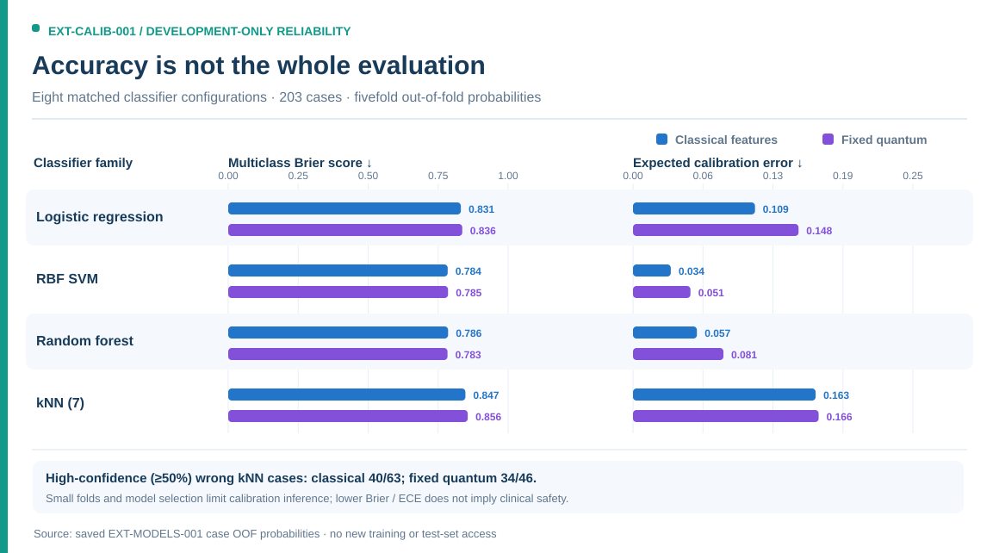</p>

The [saved probability-reliability metrics](07_Results/exp_calib_001/calibration_metrics.json) and [ten-bin calibration records](07_Results/exp_calib_001/calibration_bins.csv) are computed from the frozen case-level out-of-fold predictions, without new training. These results are descriptive: neither model selection nor confidence calibration has been validated on an independent patient cohort. These eight case-level probability-quality results are also checked by the standalone, dependency-free [calibration evidence verifier](05_Source_Code/verify_calibration_artifacts.py). It independently recomputes 1,624 case predictions, eight confusion matrices, Brier scores, negative log likelihood, predictive entropy, confidence error counts, ten-bin ECE, and 80 calibration bins; the [successful GitHub Actions run](https://github.com/karthikaxiom/QCNN_Thyroid_Paper_Reproduction/actions/runs/40662104959) verifies these stored computations alongside the five-seed stability evidence. **These are source-file audit checks, not full independent model retraining or patient-level validation.**


## Integrity and Method-Fidelity Findings

- All four independently recomputed historical metric checks agreed with stored prediction records.
- The 480 raw images contain 471 distinct exact-file contents; no exact file duplicate was found crossing two assigned split partitions.
- Perceptual screening flagged three different-split image pairs. Visual inspection found no identical frames in these pairs, but images alone cannot verify distinct patients.
- The published paper's 128×128 original-image quantum input, data inventory, augmentation and image-level split differ from the strict 64×64 ROI case-level audit. The extension is **not an exact numerical reproduction** of the original reported 127-image or 98-image tests.
- A separate audit of the historical quantum patch cache found **no key collisions in the original-image training arrays**, but identified lossy reuse of quantized keys for **2.30%** of binary-SMOTE and **11.60%** of TI-RADS-SMOTE patch occurrences. These are cache-key mismatches, not directly measured Pauli expectation or accuracy errors. The original model results have not been overwritten; the [full cache audit](07_Results/exp_cache_001/quantum_cache_key_audit.json) records the exact inputs and counts.

## Matched Classifier-Family Comparison

To investigate the near-single-class output of the historical Phase 14 CNN, an additional **training-only**, case-stratified comparison examined four fixed classifier families on each of two 64-feature representations. The original Phase 14 matrices and test results remain unchanged. Both representation arms used the same 203 training case IDs and five folds, and the archived logistic-regression predictions were reproduced before accepting the new results.

| Classifier | Classical case accuracy | Fixed-quantum case accuracy |
| --- | ---: | ---: |
| Logistic regression | 26.60% (54/203) | 21.18% (43/203) |
| RBF SVM | 28.08% (57/203) | 26.60% (54/203) |
| Random forest | 26.60% (54/203) | **31.03% (63/203)** |
| 7-nearest neighbors | 28.57% (58/203) | 29.06% (59/203) |

<p align="center">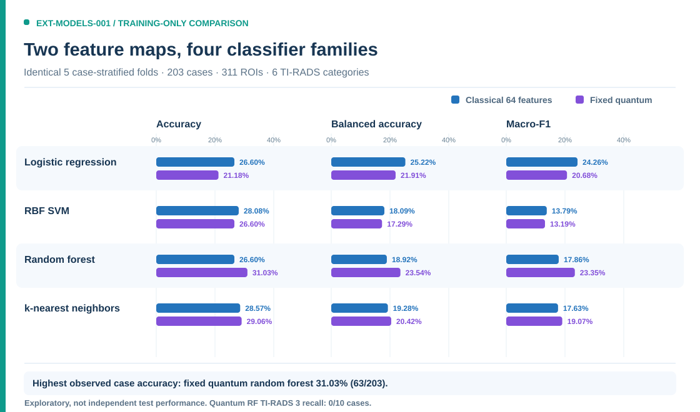</p>

The quantum-feature random forest achieved the highest **observed accuracy** but was only **6/203 cases** above the 57/203 majority-class accuracy reference. The exploratory paired exact McNemar test for quantum random forest versus the majority predictor gives **p = 0.5504**. Compared with the *classical random forest*, its accuracy difference was +4.43 percentage points, with a paired case-bootstrap 95% interval of −1.00 to +9.85 points and exact McNemar **p = 0.1755**. Neither comparison establishes superiority.

Class-level performance remains weak. Despite predicting all six categories, the quantum random forest correctly identified **0/10 TI-RADS 3 cases**. Classical logistic regression yielded the highest observed balanced accuracy (25.22%) and macro-F1 (24.26%) in this comparison. The two SVM variants predicted only four of the six categories. **Predicted-class coverage alone does not establish reliable classification.**

These are exploratory, multiple, training-only cross-validated comparisons—not a new patient-independent holdout or a full trainable quantum CNN evaluation. Source-backed [confusion matrices and paired results](07_Results/exp_models_001/metrics.json), [case-level probabilities](07_Results/exp_models_001/case_predictions.csv) and [ROI-level probabilities](07_Results/exp_models_001/oof_predictions.csv) are preserved for independent review.

## Repeated Case-Fold Stability (EXT-STABILITY-001)

The earlier eight-classifier result used one fivefold case assignment (seed 42). To examine how much the observed classical/quantum ranking depended on that assignment, a **predeclared five-seed stability audit** repeated the *same* case-stratified fivefold protocol with seeds **42, 101, 202, 303 and 404**. It used only the same **203 training case IDs / 311 ROIs**, two existing fixed 64-dimensional feature representations and two prespecified classifier families (logistic regression and random forest). Classifier settings and simulated quantum filter remained fixed; only the case-fold assignment changed. This is **not** another model-tuning exercise.

| Case-level model | Accuracy, five-seed mean ± SD | Mean six-class balanced accuracy | Mean macro-F1 |
| --- | ---: | ---: | ---: |
| Classical logistic | 24.53% ± 2.42 pp | 23.23% | 22.07% |
| Fixed quantum logistic | 23.55% ± 1.61 pp | 23.64% | 22.08% |
| Classical random forest | 27.49% ± 2.71 pp | 20.42% | 19.62% |
| Fixed quantum random forest | **29.36% ± 1.58 pp** | 22.50% | 22.30% |

<p align="center">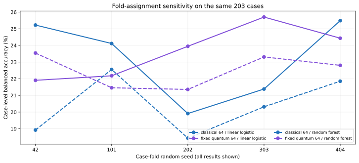</p>

The fixed-quantum forest was **not** ahead on every partition: quantum-minus-classical random-forest accuracy differed by **+4.43, −1.48, +2.46, +2.96 and +0.99 percentage points**, respectively. The mean difference was **+1.87 points**. For logistic regression, the quantum-minus-classical accuracy difference also changed sign across seeds (mean **−0.99 points**). These are descriptive averages across repeated folds of the **same cases**, not independent-replication estimates or confirmatory evidence of quantum superiority.

**Persistent minority-class failure:** In the repeated case-fold predictions, **both random-forest variants had zero TI-RADS 3 recall (0/10) on *every one* of the five seeds**. This means 10 distinct training case IDs were consistently missed under five different development fold assignments; it does **not** mean 50 independent patients were evaluated. In contrast, the two logistic variants retrieved some TI-RADS 3 cases, demonstrating that classifier-family choice affects classwise behavior. The fixed-quantum random forest scored **55/203 cases (27.09%)** at seed 202, below the **57/203 cases (28.08%)** training-set majority baseline. Thus its five-seed mean advantage in raw accuracy conceals a persistent category-specific blind spot and at least one below-baseline partition. These are descriptive findings from the same cases, not a causally identified mechanism.

An independent read-back audit checked all **4,060 out-of-fold case prediction records** across 20 model/seed combinations and recomputed accuracy, balanced accuracy, macro-F1 and confusion matrices with **zero discrepancies**. All **812 seed-42 case-probability vectors** matched the archived classifier record within a maximum absolute difference of **1.11 × 10⁻¹⁶**. The executable [stability experiment](05_Source_Code/exp_stability_001_repeated_casecv.py), [full result metrics](07_Results/exp_stability_001/metrics.json), [per-seed score table](07_Results/exp_stability_001/seed_metrics.csv), and [case-level probabilities](07_Results/exp_stability_001/case_oof_predictions.csv) are available for inspection.

**Interpretation:** Reassigning folds changes model ranking. Random-forest overall accuracy remains low, with limited class-balanced performance. All reported observations are exploratory on training-case folds; the five seed estimates are correlated, the circuit is fixed and simulated, and case-ID separation does not establish patient identity. No untouched patient-level clinical test or cross-dataset validation was performed, and no result establishes a quantum computational or diagnostic advantage.

### Recheck saved predictions independently

The stored five-seed stability evidence can be independently recomputed **without the raw DDTI images, GPU/quantum simulation, or any third-party Python dependencies**:

```bash
python 05_Source_Code/verify_stability_artifacts.py
```

This read-only verifier checks **4,060 saved case-level OOF records**, all 20 confusion matrices and score sets, paired feature-map differences, across-seed summaries, and **812 seed-42 probability vectors** against the earlier saved classifier results. It rejects inconsistent data rather than recreating outputs. The [research-only GitHub Actions workflow](.github/workflows/saved-evidence-audit.yml) uses sparse checkout to avoid collecting source medical images; its [passing independent runner audit](https://github.com/karthikaxiom/QCNN_Thyroid_Paper_Reproduction/actions/runs/40659551185) confirms that the archived evidence can be checked in a fresh Linux environment. It does **not** reproduce the model training, establish patient identity, or validate clinical claims.

For complete numeric and split-integrity review, the same dependency-free checks also include:

```bash
python 05_Source_Code/verify_calibration_artifacts.py
python 05_Source_Code/verify_master_inventory.py
python 05_Source_Code/verify_frozen_case_splits.py
```

The [successful integrated GitHub Actions audit](https://github.com/karthikaxiom/QCNN_Thyroid_Paper_Reproduction/actions/runs/40663165948) verified **all 21 consolidated metric rows** against five original results archives, the **291 distinct recorded case IDs and 440 processed ROI metadata records** across frozen train/validation/test partitions, all eight classifiers' probability-calibration summaries, and five-seed stability metrics. No original ultrasound JPG/XML is downloaded by this sparse-checkout audit. This establishes integrity of *saved* evidence and case-ID partitions, not independent patient identities, clinical validity, data-use permission, or end-to-end retraining reproducibility.

The [scientific-contribution and novelty review](Research_Extension/SCIENTIFIC_CONTRIBUTION_AND_NOVELTY_REVIEW.md) defines the QuCNet/DDTI-specific research questions, dated 2025–2026 comparator literature, supported contribution claims, explicit nonclaims, and anticipated peer-review objections. This is a pre-manuscript research gate, not a declaration of journal acceptance or an algorithmic novelty claim.

### External validation feasibility (Gate 2)

I reviewed independent thyroid-ultrasound cohorts against the **actual six-category evaluation target** rather than assuming that an additional public dataset would automatically be a fair external test. The [source-grounded external-validation gate review](Research_Extension/EXTERNAL_VALIDATION_FEASIBILITY_GATE.md) screens ThyroidXL, Stanford cine-clip, TN3K and TN-SCUI2020. These resources provide useful clinical imaging evidence, but none was established as a directly compatible, independent **2/3/4a/4b/4c/5** grading benchmark. In particular, ACR TR1–TR5 and pathology-confirmed benign/malignant labels are **not interchangeable** with the archival source taxonomy. ThyroidXL is access-gated and the public card contains count inconsistencies requiring provider/version checks; the TN-SCUI challenge also restricts image reuse outside its challenge.

**Decision:** No independent six-class external clinical validation has been performed or claimed. The existing research remains a methodological reproduction and evaluation audit, while a distinct, guide-approved pathology-grounded study would require its own prospective protocol and permissions. No new dataset was downloaded or trained on as part of this feasibility review.

The primary source-backed metric inventory is [MASTER_VERIFIED_RESULTS.csv](Research_Extension/MASTER_VERIFIED_RESULTS.csv). Full independent calculations and limitations are in [FINAL_RESEARCH_VERIFICATION_MATRIX.md](Research_Extension/FINAL_RESEARCH_VERIFICATION_MATRIX.md); the original-paper comparison and figure production checks are in [ORIGINAL_PAPER_FULLTEXT_FIDELITY_AUDIT.md](Research_Extension/ORIGINAL_PAPER_FULLTEXT_FIDELITY_AUDIT.md) and [IEEE_FIGURE_PREFLIGHT.md](Research_Extension/IEEE_FIGURE_PREFLIGHT.md). Executable experiment sources and generated evidence remain under `05_Source_Code/exp_*.py` and `07_Results/exp_*/`.

The results support analysis of reproducibility limitations, not pathology-confirmed diagnosis, clinical validation, quantum computational advantage, or a definitive model-superiority claim. Reuse of raw medical images is separate from publication of source-backed derived numerical results.

---

M.Tech Information Technology  
University Visvesvaraya College of Engineering  
Bengaluru, India

